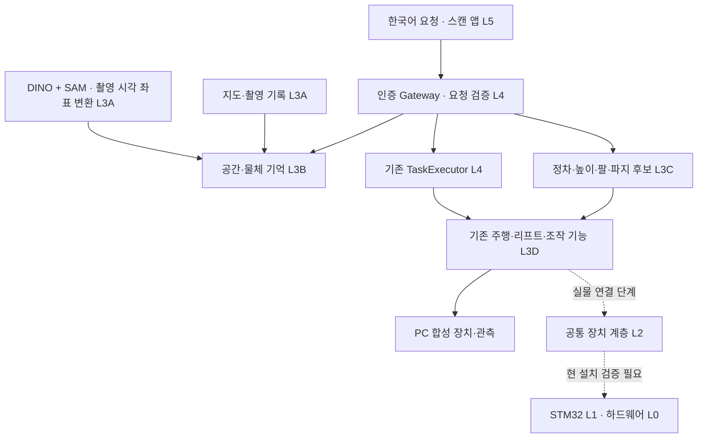

# 홈 어시스턴트 — 구현과 다음 연결 단계


> 2026-11-05 최신: [S2 좌표 연결 인계](S2_HANDOFF.md). 합의한 개발 범위 S2 완료. D415＋양팔 12축＋리프트의 정지 상태 통합 조회와 촬영 시각 좌표 계산 통과. 다음은 S3 작업 정확도·집기 개발이며 상시 관측/자동 원점 복귀도 연결해야 한다.

2026-10-29 · 개발 브랜치 `codex/home-assistant-v02`

자연어 입력, 공간·물체 기억, 스캔 검토, 정차·리프트 후보 선택을 기존 작업 실행기에 연결했다. **현재 실행 가능한 것은 PC 소프트웨어 검증 모드다. 실물 자율주행·집기 완료를 의미하지 않는다.** v0.2–v0.4 구현 중 Jetson 접속, 카메라/모터 구동, 펌웨어 배포, 모델 다운로드는 수행하지 않았다.

설계 기준은 [요구사항과 시스템 설계](MOBILE_MANIPULATION_DESIGN.md)다. 이 문서는 실제 구현 범위와 실행 방법을 관리한다.

## S0 설치 조사

S0 당시 양팔 연결·팔 모터 전원 꺼짐과 LDS-01 케이블 미연결은 사용자 확인 사항이었다.
Jetson 환경, D415 프레임 수신, ST-LINK 연결을 확인했다. 현재 flash는 텔레옵 v3.1
후보 HEX와 일치한다. CPU 실행을 확인했고, 이후 수정·리셋 없이 INFO 재연결 검사도 통과했다. 앞선 무응답과 UART 오류의 원인은 미확정이다.
2026-11-05 LDS-01 연결과 360도 거리 수신을 확인했다. 체크섬 오류는 없으나
간헐적 수신 공백은 `LDS01-SCAN-CADENCE`로 남겼으며 ROS scan·지도·주행은 미검증이다.
[S0 공유 요약](HOME_ASSISTANT_S0.md)과 로컬 `output/home-assistant/s0/installation.audit.json`에
근거와 미확인 항목을 구분했다. 수집 도구 검사 3개를 통과했다.
모터 명령·펌웨어 변경은 수행하지 않았다.

## S1 결과와 S2 시작 — 2026-11-01

[공통 제어 기록](HOME_ASSISTANT_S1.md): 16개 모터 조회, 양팔 Home 2048 보정·전원 재인가 유지, 왼팔 범위 측정·오른팔 동일 범위 적용, 리프트 약 90→26cm 단일 하강 측정을 확보했다. 현재 설치는 리프트 전용 v4이며 공통 실행·양팔/베이스 실물 동작·리프트 원점 복원은 미완료다.

사용자는 하강 소음을 최종 실물 이슈로 이관하고 다음 개발 진행을 결정했다. **현재 개발은 [S2 좌표와 관측](HOME_ASSISTANT_S2.md)**이다. 카메라는 사용자 확인상 베이스 또는 고정 기둥에 있으며 리프트와 함께 움직이지 않는다. 실측 리프트 값과 미측정 장착 변환을 별도로 관리하고, 모의 모델 치수를 실측으로 취급하지 않는다.

## S2 공식 규격과 설치 수락 경계 — 2026-11-05

대상은 공식 **ALOHA Mini 1 + SO-ARM101**이다. 원본 URDF/프로필을 커밋·해시로 고정하고,
팔 내부 링크/축은 공식 SO101 new_calib 규격, 리프트는 Mini 1의 84mm/회전으로 모델링한다.
기존 약 85.34mm/회전 관측 및 구동 설정은 그대로 보존한다. 현재 Home 2048, 양팔 장착,
고정 D415, 리프트 원점은 별도 설치 증거로 검증한다.

`s2_coordinates.py`는 입력 준비 → 보정/독립 위치·방향 검사 → 동기화 관측/기존
DINO·SAM 경계 연결 → 좌표 전용 URDF 출력 → 재시작 후 원점 재연결을 제공한다.
미측정/실패/모의 자료는 실물 S2 완료가 되지 않는다. 아직 현장 실측과 실제 장치의
통합 읽기 검증은 남아 있다. [실물 확인 순서와 완료 기준](HOME_ASSISTANT_S2.md)을 따른다.

S2 후속 진행: 바닥→베이스 밑판 아랫면 약 28mm 실측을 반영했다. 팔 장착판의
CAD+실측 바닥 기준 높이는 약 25.6–90.0cm다. `camera-evidence` 명령을 추가해
D415 저장 촬영의 장치/스트림/SDK 보정값을 S2 식별 계약에 연결한다. 새 보정 입력에
과거 26cm를 자동으로 넣지 않는다. 2026-11-05 Jetson에서 고정 D415 USB 3.2 연결,
90프레임 촬영과 SDK 보정값 검증을 완료했다(약 29.09fps, 최종 깊이 유효 비율 90.35%).
`camera_device.observed.json`에 일련번호 원문 없이 결과를 저장했다. 양팔 Home 대응은
보류 중이며 다음 실물 단계는 카메라 외부 보정용 독립 베이스 기준점 확보다.
이번 결과는 장착 변환·로봇 시각 동기화·S2 완료를 의미하지 않는다.

## v0.4 요구 반영: 지도 생성 단계의 높이 반영과 기술 선택

인식 모델을 DINO·SAM에 고정하지 않는다. 현재 구성과 YOLOE·경량 가구 분할 모델 등을 같은 기록 자료와 실제 Jetson 동시 처리 조건에서 비교한다. [평가 기준과 지도 엔진 후보](PERCEPTION_MAPPING_DECISIONS.md)에 역할·비교 지표·미확정 항목을 기록했다. 모델 교체·다운로드·실측 벤치마크는 아직 수행하지 않았다.

`ScanManager.build_navigation(session_id, volume, envelope, now_s=...)`를 추가해 스캔 과정에서 높이 장애물 반영 지도를 생성한다. 센서/기록 adapter는 먼저 `scan.depth_epoch(session_id)`로 깊이 volume을 초기화하고 해당 지도·보정 기준의 프레임을 누적해야 한다. `save`는 LiDAR 원본과 생성된 주행 지도, 생성 근거·운반 외형을 한 번에 저장한다. 재시작 후 `activate_scan`은 생성된 지도를 읽으며 현재 운반 외형과 보정의 일치를 확인한다. 이때 최신 위치 확인은 별도로 필요하다.

높이 자료 없이 저장한 기존 스캔은 `scan_record_only`로 남기며 주행 활성화를 거절한다. 앱에도 높이 관측 대기와 주행 지도 미완성을 표시한다. 따라서 예시 지도만 넣는 기존 스캔 앱 흐름은 기록 저장까지의 예제이고, 전신 주행 지도가 생성되었다고 표시하지 않는다. 스캔 중 생성된 합성 지도가 있으면 앱은 그 지도를 우선 보여준다.

추가 시험은 `tests/test_scan_map_generation.py`다. 침대 다리만 보인 LiDAR 원본과 RGB-D 몸체를 합쳐 저장하고, SQLite를 닫은 뒤 새 서비스/clock으로 열어 새 카메라 입력 없이 침대 차단·우회가 유지되는지 검사한다. 높이 없는 기록, SLAM revision 변경, 보정·운반 높이/폭 변경, 저장 데이터 변조도 검사한다. 이 경로는 소프트웨어로 연결했으며 **라이브 스캔 adapter·3D volume/키프레임 영속 저장·Nav2 전역 publisher는 아직 남아 있다.** 현재 참고 구현을 대규모 집의 제품용 지도 엔진으로 검증한 것은 아니다.

v0.4 검증: 전체 **1,374 통과 / 2 모듈 건너뜀** (`scan-generation-regression.xml`). 이후 지도 생성 중 스캔 취소 경쟁 처리를 보완하고, 새 지도 생성 10개 사례를 포함한 관련 **50개 검사 통과** (`scan-generation-final-targeted.xml`). 화면 스크립트 구문·Git 공백 검사도 통과했다. 실물 센서·로봇은 연결하지 않았다.

## v0.3 요구 반영: API 의미 추출·가구 지도·전신 주행

2026-10-29 추가 변경. 아래 변경은 기록/합성 입력으로 검사한 연결부이며, 실제 집의 자동 스캔이나 외부 언어 API 연결 완료를 뜻하지 않는다.

| 계층 | 추가 구현 | 아직 연결할 것 |
|---|---|---|
| L5 → L4 | `assistant/meaning.py`: API가 추출한 의미를 동일 요청 검증·기억 조회·계획 흐름으로 수용. 좌표/모터 명령/미지원 의미 거절, 중복 ID 충돌 검사 | 외부 API 업체·모델·키, 별도 추론 작업의 timeout·취소·비용 평가. 기존 화면은 오프라인 규칙 파서 사용 |
| L3A → L3B | `assistant/furniture.py`: SAM 마스크+정합 깊이+촬영 시각 변환 → 관측 voxel·부분 범위 → 가구 기록. 고유한 공간 겹침으로 다중 시점 연결, 여러 후보는 모호함 유지 | 실시간 DINO/SAM 가구 프롬프트 연결, 시각 특징 기반 재식별, 포즈 그래프 보정 후 재투영 |
| L3B → L5 | 가구 기록 API·SQLite 저장·지도 표시. 방 이름을 먼저 정하지 않아도 침대·소파 위치 저장 가능 | 스캔 세션과 가구의 소속 관계 자동 연결, 현장 오탐·중복 평가 |
| L3A → L3D | `navigation_fusion.py`: LiDAR 원본을 보존하고 전체 높이 깊이와 합친 별도 계획 지도 생성. 기존 `NavigationMap` 경로 계산으로 침대 우회 검증 | 실측 ALOHA 운반 외형, 전역 map 좌표 깊이 입력·Nav2 publisher. 기존 ROS 깊이 후보는 국소 지도 연결만 존재 |

언어 API 결과는 인증된 `POST /v1/assistant/interpreted-requests`로 받는다. 원문과 요청 ID는 API의 임의 출력에서 가져오지 않고 호출한 사용자 입력에 고정한다. 요청 형식은 다음과 같다.

```json
{
  "request_id": "text-001",
  "utterance": "거실 탁자의 검정 매직, 침실 협탁에 옮겨줄래?",
  "meaning": {
    "operation": "fetch_object", "category": "marker",
    "attributes": {"color": "black"},
    "source_phrase": "거실 탁자", "destination_phrase": "침실 협탁",
    "issues": []
  }
}
```

이 요청은 의미 해석·기억 조회까지만 수행한다. 실행은 기존 계획 확인·실행 허가 경로를 거친다. 미지원 수식·부정문·다중 행동은 API가 `issues`에 남겨야 한다. 형식 검증만으로 API의 의미 해석 정확성이 보장되지는 않으므로 별도 문장 평가가 필요하다. 네트워크 추론을 Gateway lock 안에서 수행하지 않으며, 현재 외부 호출·집 영상 전송은 없다.

가구 입력은 `masked_furniture(...)`로 만들고 `FurnitureMemory.observe(...)` 또는 인증된 `POST /v1/assistant/furniture/observations`의 `{"observation": ...}`로 기록한다. RGB-aligned metric depth·RGB intrinsics·촬영 시각 변환이 필요하다. 검은/반사 표면의 부족한 깊이를 임의로 채우지 않는다. 범위는 **관측된 부분**이며 정확한 가구 전체 치수·놓을 면·물체 파지 위치가 아니다. 현재 동일 종류의 고유 voxel 겹침을 연결하는 추정 방식이므로 시점 간 겹침이 없으면 중복 인스턴스가 생길 수 있다. 지도/보정 revision이 바뀌면 옛 좌표를 숨긴다. 재부팅 시에는 기억을 유지하지만 최신 충돌 공간으로 쓰지 않는다. 삭제/이동 판정·모델 버전 기록·가구별 전경 점군 정제는 후속 연결 항목이다.

충돌 판단에는 가구 마스크가 아니라 **분류 결과와 무관한 전체 native depth**를 사용한다. `fuse_navigation_map`은 같은 frame·격자·보정/epoch를 요구하고 실측 전신 `TravelEnvelope`를 입력받는다. LiDAR occupied 또는 높이 장애물이 있으면 차단하고, 모든 높이의 관측 근거가 없으면 unknown으로 둔다. 전역 경로 제안은 스캔 이력의 free를 이용할 수 있지만 국소 투영과 `TravelGuard`는 최신 free만 인정한다. 생성 지도는 새 revision을 가진다. v0.4에서 스캔 생성·저장·검증된 명시적 활성화까지 연결했으며 원본 SLAM 지도는 보존한다. 키프레임 재투영·누적 3D 기하 영속 저장·Nav2 전역/국소 배선은 아직 실물 연결 전이다.

추가 검사: `tests/test_semantic_home_mapping.py`의 29개 사례를 포함해 전체 **1,365 통과 / 2 모듈 건너뜀**. 합성 가구 지도 표시도 브라우저에서 확인했고 오류·경고 로그는 없었다. 외부 의미 입력, 가구 관측 변환·저장·재시작·모호한 결합, 4개 침대 다리 사이의 잘못된 직진 경로 차단/우회, 미관측 상부와 오래된 관측, 다른 좌표·보정·높이 범위 거절을 검사한다. 전체 결과는 `output/home-assistant/semantic-mapping-regression.xml`에 별도로 기록한다. 기존 아래 v0.2 결과표는 이전 검사 이력이다.

## 바로 확인하기

현재 프로젝트의 바깥 루트 또는 이 모바일 작업 폴더에서:

```bash
python3 tools/run/home_assistant.py serve
```

브라우저에서 `http://127.0.0.1:18766/assistant`를 연다. 터미널에 표시되는 **접속 키 파일**의 내용을 로그인 입력란에 넣는다. 최초 실행 시 생성되는 키와 요청·공간 기록은 모바일 작업 폴더의 `output/home-assistant/`에 저장된다. 기본 서버는 이 컴퓨터 안에서만 접속한다.

1. **예시 관측 갱신** → **예시 시작 위치 확인**을 누른다.
2. “거실 탁자에 있는 검은 마커펜을 침실 협탁에 놓아줘”를 입력한다.
3. **요청 이해하기 → 동작 계획 보기 → 소프트웨어 실행** 순서로 확인한다.
4. 15단계 완료 후 마커의 기억 위치가 침실 협탁으로 바뀐다. 합성 센서와 동작 결과를 사용하므로 실물 성공률을 나타내지 않는다.
5. “검은 컵을 협탁에 놓아줘”는 컵 A/B 중 하나를 질문한다. “마커펜 가져다줘”는 놓을 자리를 질문한다.
6. **우리 집 스캔 → 스캔 시작 → 예시 관측 넣기 → 지도 검토 → 이름 저장 → 저장하기**로 스캔 앱의 흐름을 확인한다.

관측 유효시간이 지나면 **예시 관측 갱신** 후 새 요청을 입력한다. 작업 종료/취소로 모의 위치가 불명확해졌다면 **예시 시작 위치 확인**이 필요하다. 서버 재시작은 예전 동작을 재실행하지 않는다.

화면 없이 확인하려면:

```bash
python3 tools/run/home_assistant.py demo
python3 tools/run/home_assistant.py demo --fail-skill pick
python3 tools/run/home_assistant.py readiness
```

첫 명령은 성공 흐름, 두 번째는 집기 실패 처리 흐름을 검사한다. 실패 주입 명령의 `FAILED` 출력은 의도한 결과다. 두 경우 모두 하드웨어 명령 수는 0이다.

## 계층별로 들어간 코드

패키지 기준 경로는 `ros2_ws/src/home_robot_tasks/home_robot_tasks/`다.

| 계층 | 이번 구현 | 주요 파일 | 현재 경계 |
|---|---|---|---|
| L5 사용자 입력 | 한국어/영어 문장 해석, 부족한 조건 질문, 후보 선택, 진행·취소 화면 | `assistant/language.py`, `web/assistant.*` | 제한된 문법·물체 종류를 지원하는 파서. LLM·음성 인식은 미연결 |
| L4 작업 관리 | 요청 저장, 계획 확인, 실행 전 재검증, 중복 요청·취소·재시작 처리 | `assistant/service.py`, `assistant/api.py`, 기존 `gateway.py` | 기존 `RobotApplication`·`TaskExecutor` 하나를 재사용 |
| L3B 의미 기억 | 방–지지면–물체 관계, 별칭, 마지막 관측, 이동·운반·놓기 상태와 변경 이력 | `assistant/world.py`, `assistant/contracts.py` | SQLite 영속 저장. 불확실·오래된 기억은 실행 좌표로 사용하지 않음 |
| L3A/B 스캔 | 시작·중지·재개·검토·저장, 지도 버전 검사, 구역 분리 제안, 가구 기반 용도 제안 | `assistant/scanning.py` | 지도/관측 기록 입력과 모의 스캔. 실시간 SLAM은 미연결 |
| L3C 작업 위치 | 베이스 XY·방향 × 리프트 높이 × 팔 × 파지 후보를 함께 평가 | `assistant/placement.py`, `assistant/placement_binding.py` | 합성 평가기 포함. 실측 IK·충돌 평가기는 주입할 인터페이스로 분리 |
| L3A 인식 연결 | DINO/SAM 결과 → 마스크 내부 깊이 → 촬영 시각의 좌표 변환·의미 관측 | `grounding_detector.py`, `capture_port.py`, `assistant/perception.py` | 모델·카메라는 주입. 현재 설치의 외부 보정 없이는 지도 좌표를 만들지 않음 |
| L3D 계획 연결 | 선택한 팔·파지 후보를 정렬/높이/재관측/집기 경로에 전달, 6축 또는 12축 계획 검증 | `mission_catalog.py`, `moveit_bridge.py`, `manipulation_port.py` | 현재 조립체의 MoveIt 실물 계획·운송은 미검증 |
| L2 상태·장치 계약 | 설치 장치 목록, 버스 ID 중복 검사, 누락·오래된 피드백 구분, 명시적 왼팔 6축 상태 | `assistant/capabilities.py`, `robot_state.py`, `planning_scene_port.py` | 미설치 오른팔을 가짜 0 좌표로 채우지 않음. 공통 장치 운용 검증은 남음 |
| L1 기존 제어 보완 | 움직임/스트림/정지 처리 중 설정용 EEPROM 읽기·재설정 진입 차단 | `firmware/stm32_g474_single_arm/Core/Src/binary_control.c` | PC에서 실제 함수와 모의 입출력으로 검사. 보드에 올리지 않음 |



언어 계층은 관절 명령을 만들지 않는다. 인식 계층은 물체를 골랐다고 파지가 성공했다고 보고하지 않는다. 베이스·리프트 후보 선택은 관측과 현재 상황에 대한 제안이고, 이동 후 새 영상과 기존 조작 계층의 검증을 거쳐야 한다.

6축 지원은 명시적인 상태·계획·장면 계약에서 검증했다. 기존 12축 스트림 경로를 6축으로 자동 전환하는 기능은 아니며, 현재 왼팔 구성의 관측 생산기·전송기·공통 펌웨어까지 연결한 실물 검사는 설치 확인 후 진행한다.

## 구현에서 지킨 연결 규칙

- 관측에는 `map_id`, `map_revision`, `calibration_id`, `clock_id`, `frame_id`, 촬영 시각, `capture_id`를 붙인다. 다른 보정·지도·시간 기준의 관측과 계획을 섞지 않는다.
- 마스크 안에서 유효한 깊이를 사용하고 경계 픽셀은 제외한다. 대표 표면점은 물체 중심·질량 중심·그리퍼 자세와 구분한다.
- 같은 물체가 여러 개면 후보를 반환한다. 색·종류·공간 조건에 맞지 않는 사용자의 선택도 거절한다. “줄무늬”, “협탁 옆” 등 아직 처리하지 못하는 조건은 버리지 않고 다시 묻는다.
- 정차와 높이는 조합으로 평가한다. 끝점 도달만 확인한 결과는 허용하지 않고 접근·접촉·들기·후퇴·운반 단계의 평가를 요구한다. 실제 평가기에서 시뮬레이션 증거를 통과 근거로 사용할 수 없다.
- 도착 위치·방향·리프트 높이를 확인하고, 이동 전 촬영을 재사용하지 않는다. 최종 집기에는 새 관측으로 만든 파지 자세와 선택했던 팔을 일치시킨다.
- 실행은 기존 인증·짧은 유효시간의 실행 허가·작업 소유권·요청 기록을 통과한다. 네트워크 재시도나 오래된 취소 요청이 새 작업을 실행/취소하지 않도록 요청 ID를 고정한다.
- 중단된 작업은 서버가 다시 켜져도 이어서 움직이지 않는다. 물체를 든 상태와 놓았지만 확인 전인 상태를 기억해 이후 요청을 차단하고 상태 확인을 요구한다.
- 스캔 기록 수집과 작업 실행은 동시에 시작하지 않는다. 예시 관측이 실측 데이터를 덮어쓰지 못하게 한다.

## 실제 구현된 수준과 남은 개발을 구분하기

| 항목 | 지금 할 수 있는 일 | 다음 개발 |
|---|---|---|
| 자연어 | 종류·색·출발 장소·놓는 자리 해석, 모호함 질문, 기억에서 찾기, 모의 옮기기 | 더 다양한 문장, 음성, 지속 대화. 자연어 이동 실행은 별도 지도 이동 화면/기존 API와 통합 예정 |
| 공간 이해 | 자유 공간을 구역으로 제안하고 침대/소파 등 관측으로 방 용도를 제안 | RGB-D·LiDAR 동기화, 실시간 SLAM, 다중 관측 융합, 학습 모델 평가 |
| 집 스캔 | 예시/JSON 지도와 관측 기록의 검토·저장, 구역 이름 확인 | 센서 점검, 실제 촬영/스캔 입력, 재위치 추정, 저장 지도 선택 UI |
| 물체 기억 | 위치·관측 시각·별칭·지지면 관계·운반 상태 저장 | 실제 재관측 간 인스턴스 추적, 가구 변경·지도 루프 보정 대응의 현장 검증 |
| 물체 찾기 | 최근/오래된 기억 구분, 후보 목록 표시 | 현재 앱의 찾기는 기억 조회다. 미발견 시 실제 주행·카메라 탐색 연결은 남음 |
| 정차·높이 | 한 번의 예시에서 36개 조합 평가, 거절 이유·비용 반환 | 실측 SO101 IK, 팔 전체 충돌, 적재·안정성, 후보 간 비교 평가 |
| 작업 완료 | 기존 실행기의 성공·실패·취소 전파와 기억 갱신 | 독립된 실측 파지/하중/해제 증거로 실제 완료 판정 |

스캔의 관측률은 **현재 지도 사각형 안의 알려진 셀 비율**이다. 집 전체를 얼마나 스캔했는지 나타내는 비율은 아직 알 수 없으므로 별도로 미확정으로 둔다. 방 용도는 가구 목록 기반 규칙 제안이며 VLM 추론이나 보정된 확률이 아니다. 저장 스캔 간 같은 방의 ID 병합과 관계 재연결도 후속 과제다.

현재 기록은 요청 128건, 스캔 64회, 스캔당 촬영 256건으로 제한한다. 이 버전은 연구용 로컬 개발 앱이며 다중 사용자·보관/삭제 정책·집별 계정 분리는 아직 구현하지 않았다. 접속 키는 브라우저 메모리에만 유지한다.

## 검증 결과

2026-10-29 실행 결과:

| 검사 | 결과 | 근거 |
|---|---|---|
| 모바일 작업 폴더 전체 회귀 | **1,336 통과 / 2 모듈 건너뜀** | `output/home-assistant/regression.xml` |
| 별도 RealSense 환경에서 위 2개 모듈 검사 | **20 통과** | `output/home-assistant/rgbd-regression.xml` |
| STM32 ARM 교차 빌드 | 왼팔 단독·양팔 resident 두 구성 성공 | `output/home-assistant/build-left.log`, `build-resident.log` |
| 자연어 → 후보 36개 평가 → 기존 15단계 실행 → 물체 기억 갱신 | `SUCCEEDED`, 하드웨어 명령 0 | `output/home-assistant/demo-success.json` |
| 집기 실패 주입 | `FAILED`, 실패를 성공으로 바꾸지 않음 | `output/home-assistant/demo-pick-failure.json` |
| 실제 브라우저 화면 | 로그인, 요청, 후보 선택, 계획, 모의 실행 완료, 스캔 검토·이름·저장 확인 | 오류/경고 콘솔 로그 없음 |

검사 요약은 로컬 `output/home-assistant/implementation-validation.json`에도 저장했다. 이 실행 기록은 GitHub에 포함하지 않는다.

일반 Python에는 `pyrealsense2`가 없어서 기존 RGB-D 두 모듈을 건너뛰었다. 이미 설치된 바깥 루트의 `.venv-realsense`에서 별도로 실행해 20개 모두 통과했다. 실제 카메라·GPU 추론·Jetson·Nav2·MoveIt·STM32 하드웨어를 이번 검사에서 실행한 것은 아니다. 펌웨어 변경은 호스트 C 테스트와 ARM 교차 빌드로 확인했다. 빌드에는 선택하지 않은 기존 함수의 미사용 경고가 남아 있으며 보드 시험은 별도다.

전체 회귀 명령은 이 모바일 작업 폴더에서 실행한다. 영상 검사에는 [RGB-D 환경 안내](REALSENSE.md)에 따라 구성한 Python 환경을 사용한다:

```bash
python3 -m pytest -c config/pytest.ini tests -q
python3 -m pytest -c config/pytest.ini \
  tests/test_grounding_rgbd.py tests/test_realsense_web.py -q
```

## 다음에 함께 확인할 입력

| 확인할 것 | 필요한 이유 | 다음 단계 |
|---|---|---|
| 현재 왼팔/오른팔 설치, 배선, 모터 ID, 실행 중 펌웨어 | 공통 제어기가 실제로 존재하는 장치만 관리해야 함 | S0 설치 목록 → S1 공통 제어 실물 검증 |
| Jetson 사양·JetPack/ROS 버전, LiDAR 모델과 연결 | 실제 실행 위치·드라이버·동시 처리 성능 결정 | S1, S4a |
| 리프트 원점·높이 환산·하중 유지, 전원 차단 거동 | 높이 후보를 실제 높이로 실행하고 물체를 안정적으로 운반 | S1 |
| 현 조립 관절 영점·URDF·TCP·카메라/LiDAR 장착 변환 | 카메라에서 본 점을 실제 팔의 작업 위치로 연결 | S2 |
| 첫 물체 2~3종·무게·집게 범위·파지/해제 확인 신호 | 성공 기준과 센서 판정·파지 후보를 정함 | S3 고정 베이스 집기 |
| 시험 공간·문턱·낙차·출입 제한·기본 놓는 자리 | 집 지도와 실제 운용 범위 결정 | S4a/S4b |
| 텍스트 의미 API 업체·모델·키, 음성 방식과 별도 영상/음성 보관 범위 | 대화 모델과 개인정보 처리 방법 결정 | L5 및 S5 |

실물 검증 순서는 **설치 확인 → 공통 제어 → 좌표 보정 → 고정 베이스 관측 집기 → 주행·스캔 → 모바일 집기 → 자연어 전체 작업**으로 유지한다. 이번에 상위 계층을 미리 구현한 것이 앞 단계의 실물 수락을 생략한다는 뜻은 아니다.

## 소스 기준과 변경 보존

개발 기준본은 바깥 저장소의 `workspaces/home-assistant` Git 작업 폴더이며 브랜치는 `codex/home-assistant-v02`다. 이전 `tmp/fixed-pick-demo`는 호환용 링크다. 바깥 루트 진입점은 이 구현을 호출한다. GitHub에서는 모바일 브랜치의 루트가 이 폴더 내용이며, 바깥 수건 프로젝트나 호환 링크 없이 실행한다. [저장소 관리](REPOSITORY_MANAGEMENT.md)를 따른다.

모바일 기반 `b1fc7cd`에서 출발했고, 이전 촬영 작업의 54개 변경 파일을 먼저 백업했다. 루트의 RGB-D/SAM 코드·검사·도구와 설계 자료 17개를 가져왔으며 출처는 `config/home_assistant/source_manifest.json`에 기록했다. 가져온 파일의 해시는 **가져올 당시 값**이다.

기존 촬영 자세와 보정 자료는 유지했다. 이번 작업 중 기존 변경 파일에 추가한 것은 설정 진입 차단과 관련 C 시험 의존성 갱신이다. Git 변경 목록에는 이전 촬영 수정도 함께 보이므로 이번 변경으로 모두 간주하지 않는다. 커밋·push·PR·실물 배포는 수행하지 않았다.
