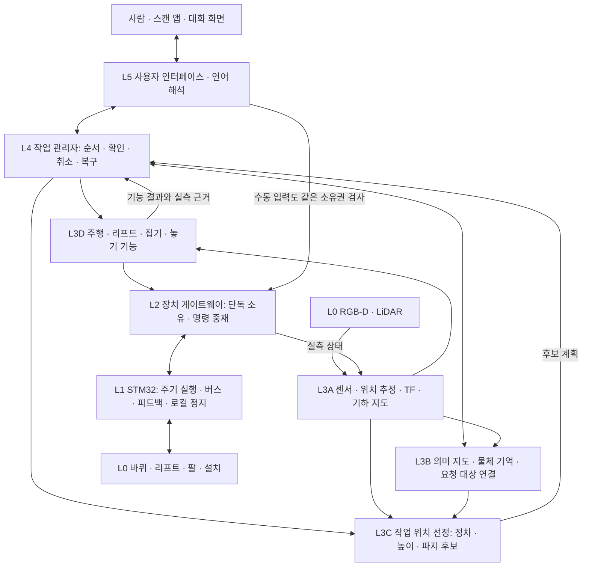

# 홈 어시스턴트 로봇 요구사항과 시스템 설계

작성일: 2029-10-29 · 설계 기준: v0.4 · 상태: 개발 기준안, 구현 완료 명세가 아님

후속 구현: [홈 어시스턴트 구현·검증 기록](HOME_ASSISTANT_IMPLEMENTATION.md).
아래 현재 상태 표는 구현 시작 전 평가이며, 이후 소프트웨어 변경과 실제 확인 결과는 해당 기록에서 관리한다.

v2.1의 정지 상태 집기 계획을 유지하면서, 자연어 대화·초기 집 스캔 앱·의미 지도·집 안 이동·물체 운반까지 제품 범위를 확장한다. 요구사항, 현재 확인된 사실, 앞으로 검증할 설계를 구분한다. 이 문서가 통합 설계의 기준이며, 새 기능은 담당 계층과 완료 기준을 정한 뒤 추가한다.

## 2. 제품 목표와 범위

**사람의 자연어 요청을 이해하고, 집 안에서 필요한 물체를 찾아 이동한 뒤, 집어서 지정한 곳에 놓고 결과를 확인하는 홈 어시스턴트**를 만든다. 최초 사용 시 앱이 집 스캔을 안내하고, 로봇은 공간과 물체의 의미를 가능한 만큼 추정한다. 사용자는 모호한 부분과 개인적인 이름만 보완한다.

대표 시나리오는 “거실 탁자에 있는 검은 리모컨을 침실 협탁 위에 놓아줘”다. 시스템은 물체·출발 장소·목적지를 구분하고, 집의 지도와 현재 관측을 이용해 대상을 확정한다. 집기와 놓기 각각에 맞는 정차 위치·방향·리프트 높이·팔 자세를 정한 뒤 실행하고, 실제 결과를 확인한다.

### 목표 수준을 구분한다

| 수준 | 달성할 동작 | 범위 |
|---|---|---|
| 첫 개발 이정표 | 위치·방향을 바꾼 물체를 관측해서 집고 놓기 | 베이스 고정, 왼팔, 검증된 작업대·물체. 저장 자세 재생으로 대체하지 않음 |
| 첫 홈 통합 버전 | 최초 스캔 → 자연어 요청 → 방 사이 이동 → 집기·운반·놓기 | 한 층, 통과 가능한 문·바닥, 접근 가능한 개방된 지지면, 검증된 가벼운 물체 |
| 후속 확장 | 더 다양한 물체·가구·사용자, 변화하는 집, 자동 탐색·충전 | 성능과 하드웨어 조건을 확인하며 확대 |

첫 홈 통합 버전의 대화는 한국어 텍스트부터 연결하고 음성 입출력은 이후 추가한다. 영어 인식 키워드는 내부 표현으로 사용할 수 있다. 사용자에게 매번 모터 값이나 좌표를 입력하게 하지 않는다. “가져다줘”의 기본 도착점은 사용자가 등록한 놓는 자리이며, 정해지지 않았으면 묻는다. 사람 손으로 직접 전달하는 동작은 별도의 검증이 필요한 후속 기능이다.

**설계 검토 후 합의:** 최초 스캔 중 로봇을 텔레옵으로 이동시킬지 자동으로 탐색하게 할지는 미정이며, S5a 개발 시 결정한다. 지도 생성·가구 관측·저장·재로드는 이동 방식과 분리한다. 자동 최초 탐색을 반드시 후속으로 미루거나, 제품의 첫 스캔을 텔레옵으로 고정하지 않는다. 개발 중 센서 자료를 수동으로 수집하는 것은 최종 스캔 방식의 결정이 아니다.

**v1.3 사용자 결정:** 자연어 입력은 외부 API로 의미를 추출할 수 있다. 로컬 규칙 파서는 오프라인 개발용이며 최종 언어 처리 방향이 아니다. 공간 이해의 핵심은 새 집을 안내 스캔한 후 RGB로 침대·소파·책상 같은 **가구 인스턴스를 알아보고 LiDAR 지도 좌표에 연결**하는 것이다. 가구 목록으로 방 용도를 붙이는 규칙은 그 위의 보조 기능이다. 플랫폼은 ALOHA Mini 1이며, LiDAR 높이에서 비어 있는 공간도 전체 몸체·팔·리프트·적재물과 충돌하면 통과할 수 없다.

초기에는 주행·리프트 이동·팔 조작을 순서대로 실행한다. 양팔 협업, 주행 중 집기, 계단 이동, 닫힌 문·서랍 열기, 액체 운반, 날카롭거나 뜨거운 물체 취급, 임의 물체의 범용 파지는 첫 수락 범위에서 제외한다. 이는 최종 비전을 축소하는 것이 아니라 검증할 운용 범위를 명시하는 것이다.

**v0.4 추가 결정:** Grounding DINO·SAM·현재 지도 구현은 비교 기준이며 고정 기술 요구가 아니다. 인식 정확도, 새 집 적용성, 실제 Jetson 동시 처리 지연·메모리, 유지보수·연결 비용을 비교해 유지하거나 교체한다. 결과가 좋으면 현재 방식을 유지한다. 기술 선택 이유와 미측정 항목은 [인식·지도 기술 선택 기준](PERCEPTION_MAPPING_DECISIONS.md)에 기록한다. 높이 장애물은 최초 스캔의 **지도 생성·저장·재로드 과정부터** 반영해야 한다.

## 2. 현재 시스템 평가와 개발 기준본

평가 근거는 로컬 코드·문서·배포 기록과 10월 16일까지의 사용자 동작 확인이다. **10월 29일 현재 하드웨어에는 접속하지 않았고 실제 배선·전원·설치 펌웨어를 새로 확인하지 않았다.** 아래의 “확인”은 반복 성능 보증을 뜻하지 않는다.

| 영역 | 확인된 상태 | 아직 필요한 것 |
|---|---|---|
| 베이스 | Jetson 터미널 텔레옵 실물 동작을 사용자가 확인 | 바퀴 환산, odometry, 속도·정지 거리, 자율주행 |
| 리프트 | 베이스·리프트 제어 도구와 제한된 위치 제어 기반 존재 | 원점·절대 높이 환산, 한계, 하중·전원 차단 시 유지 검증 |
| 왼팔·집게 | 재조립 후 6축 2048 보정, 5개 자세 재생, Home 이동·집기·들기 사용자 확인 | 현재 설치의 관절 영점·URDF·TCP, IK·충돌 검사, 자동 파지 판정 |
| 인식 | D415 + Grounding DINO + SAM 2.1, 키워드 검색·마스크·카메라 XYZ 표시 | 물체 인스턴스 확정, 다중 관측, 로봇 좌표 변환, 파지 후보 |
| 좌표 | 마스크 안의 유효 깊이 표면점 계산 | 카메라 외부 보정, 촬영 시각 TF, 오차 검증. 현재 점은 물체 중심이나 파지 자세가 아님 |
| 제어 통합 | 촬영 시 팔 집기와 텔레옵을 펌웨어 교체로 번갈아 사용 | 같은 펌웨어·포트에서 장치·모드 전환 |
| 상위 소프트웨어 | 별도 작업 폴더에 작업 상태 머신·장치 adapter·모의 실행과 결과 검증 계약 존재 | 실제 장치 연결, 현재 왼팔 단독 구성 검증 |
| 지도·주행 | 관련 설계·연결 기반 존재 | 2D LiDAR 실장·SLAM·위치 추정·Nav2의 현 구성 실물 검증은 미확인 |
| 공간 이해 | 등록 장소·검색 구조 일부 존재 | 자동 방/가구 추정, 지속적인 물체 기억, 지도 변경 처리 |
| 앱·자연어 | 영상 뷰어·조작 UI와 상위 UI 기반 존재 | 스캔 안내 앱, 한국어 대화·모호함 해소, 실제 작업과 연결 |
| 웹 텔레옵 | 연결 만료 문제가 있었고 터미널로 촬영 완료 | 웹 문제의 해결 완료 근거 없음 |

평가는 **개별 기능의 실물 시연과 상위 소프트웨어 기반이 있는 상태이며, 자율 홈 어시스턴트로의 통합 검증 전**이다. 코드 파일 수나 촬영 성공을 전체 완성률로 환산하지 않는다.

근거: [RGB-D 기록](REALSENSE.md), [표면점 구현](../tools/lib/grounding_rgbd.py), [SAM 구현](../tools/lib/sam_rgbd.py), [모바일 기존 설계](ARCHITECTURE.md), [작업·장치 계층](../ros2_ws/src/home_robot_tasks/home_robot_tasks/), [r5 집기 배포본](../../../output/left-pose-replay-20261016-r5/), [텔레옵 복원 기록](../../../output/teleop-filming-20261016/). 배포 기록의 검사 결과와 이후 사용자 실물 확인은 구분한다.

인식 기록에는 마커펜 요청에 드라이버도 검출된 사례가 있다. SAM은 검출된 대상의 윤곽을 만드는 역할이므로, 잘못 선택한 대상의 마스크가 정확할 수도 있다. 카메라 FPS와 DINO/SAM 처리 속도도 별개다. 현재는 촬영본 단위 처리이며 연속 물체 추적을 검증한 상태가 아니다.

### 소스 통합 출발점

바깥 루트는 `towel-yolo-baseline-20260827` / `bfdea72`의 수건 프로젝트다. 모바일 개발 기준본은 바깥 루트의 `workspaces/home-assistant` 작업 폴더다. `codex/fixed-pick-demo` / `b1fc7cd`와 기존 촬영 수정을 보존한 상태에서 **`codex/home-assistant-v02`**로 분기하고 RGB-D 코드를 모았다. 별도 `codex/aloha-home-robot` 작업 폴더의 `8f1da75`는 더 오래된 기반이다.

S0의 소스 수집과 기존 변경 백업은 진행했다. 코드 출처·수정 범위·검사 결과는 구현 기록에 명시하며, 현재 설치 확인과 공통 제어의 실물 검증은 남아 있다. 보존할 항목은 다음과 같다.

- 제어 시각과 보간 시각 일치, 구간 연결, 일시 busy와 fault 구분 등의 실제 오류 수정과 재현 테스트.
- 왼팔 단독 지원을 설치 장치 목록·유효 마스크로 일반화한 공통 제어.
- DINO·SAM·원본 깊이 처리와 관측 품질 검사.
- 촬영용 5개 자세·집게 닫힘 값은 회귀 자료로 보존. 범용 파지 정책으로 사용하지 않음.
- 이전 고정 작업대 보정은 과거 설치의 자료. 재조립된 모바일 로봇에 자동 적용하지 않음.

## 3. 요구사항과 수락 근거

**필수**는 첫 홈 통합 버전의 요구사항이고, **후속**은 그 이후의 확장이다. 표의 검사는 앞으로 수행할 수락 시험이며 현재 통과 결과가 아니다. 계층 이름은 4절에서 정의한다.

### 사람과의 상호작용

| ID | 요구사항 | 담당 | 수락 근거 | 우선 |
|---|---|---|---|---|
| U01 | 한국어 요청을 동작·물체·출발 조건·목적지로 구조화 | L5, L4 검증 | 표현이 다른 같은 요청의 의미 일치, 미지원 요청 구분 | 필수 |
| U02 | 같은 물체 여러 개·모호한 장소·누락 목적지는 필요한 부분만 질문 | L4, L3B, L5 | 사진/위치로 후보를 구분하며 임의 선택하지 않음 | 필수 |
| U03 | 진행 상황·실패 이유·취소 결과를 이해할 수 있게 표시·응답 | L5, L4 | 화면과 실제 작업 상태 일치, 실패를 성공으로 말하지 않음 | 필수 |
| U04 | 작업 중 취소·대상 변경과 UI 재접속을 처리 | L4, L2, L5 | 이전 동작 정지 확인 후 변경, 재접속 시 자동 재실행 없음 | 필수 |
| U05 | 지속 대화의 “그 컵”·사용자별 소유물·개인별 목적지를 기억 | L5, L3B | 사용자 구분·수정·삭제 가능, 확인되지 않은 소유 관계 추정 금지 | 후속 |

### 최초 스캔과 공간 기억

| ID | 요구사항 | 담당 | 수락 근거 | 우선 |
|---|---|---|---|---|
| M01 | 앱에서 센서 점검·스캔 시작·안내·중지·재개·저장 | L5, L4, L3A | 비개발자가 지도·현재 위치·미관측 구역을 보고 스캔 완료 | 필수 |
| M02 | 2D LiDAR 기반 주행 지도와 재시작 후 위치 추정 | L3A | 저장·재로드·재위치 추정, 위치 불확실 시 이동 차단/복구 | 필수 |
| M03 | RGB-D로 가구·지지면·물체의 위치·높이·관계를 지도와 연결 | L3A, L3B | 서로 다른 시점의 같은 대상을 연결하고 좌표 일관성 확인 | 필수 |
| M04 | 방/구역의 경계와 용도를 자동 제안하고 수정 허용 | L3B, L5 | 미리 모든 방을 라벨링하지 않고 제안, 불확실·혼합 공간 표시 | 필수 |
| M05 | “내 방” 등 별칭, 출입 금지·저속 구역·기본 놓는 자리를 관리 | L3B, L3A, L5 | 지도 재로드 후 보존, 주행에 실제 반영, 변경 이력 확인 | 필수 |
| M06 | 물체의 마지막 관측·이동·운반·놓기 상태를 갱신 | L3B | 다른 위치로 옮긴 물체를 옛 위치의 확정 사실로 사용하지 않음 | 필수 |
| M07 | 지도 버전·루프 보정·보정 변경 시 관련 좌표와 계획을 갱신/무효화 | L3A, L3B, L4 | 지도 변경 전 계획의 잘못된 실행 방지 | 필수 |
| M08 | 최초 스캔의 이동 방식을 텔레옵 또는 자동으로 선택 | L4, L3A–D, L5 | S4a에서 사용자 개입·관측 범위·중단/복구를 비교. 자동 선택 시 미탐색 구역 선택·시간 제한·복귀도 검증 | 방식 미정 |
| M09 | 가구의 RGB 인식·마스크·깊이를 다중 관측으로 지도에 누적 | L3A–B | 새 집의 침대·소파·책상 위치를 수동 좌표 입력 없이 제안. 다른 가구의 병합·중복·가림·오분류를 별도 평가 | 필수 |
| M10 | 최초 스캔 지도 생성·저장부터 LiDAR와 전신 높이의 깊이 장애물을 융합하고 재로드 | L3A, L3D, L2 | 새 깊이 프레임을 받기 전에도 저장 지도에서 침대 몸체·돌출 상판이 차단됨. LiDAR free가 높이 장애물을 지우지 않음. 미관측·깊이 유실은 통과 증거가 아님 | 필수 |

### 물체 선택과 이동·조작

| ID | 요구사항 | 담당 | 수락 근거 | 우선 |
|---|---|---|---|---|
| A01 | 언어·모양·색·장소·관계를 결합해 대상 인스턴스를 확정 | L3B, L4 | 비슷한 대상·오탐·대상 없음에서 잘못된 집기 차단 | 필수 |
| A02 | 기억 위치에서 못 찾으면 다른 시점/장소를 유한하게 탐색 | L4, L3B–D | 탐색 예산 종료, 미관측과 부재를 구분해 보고 | 필수 |
| A03 | 집기/놓기 정차 위치·방향·리프트 높이·파지 방향을 함께 선정 | L3C | 전체 접근·집기·후퇴가 가능한 후보와 거절 이유 반환 | 필수 |
| A04 | 장애물을 피해 이동하고 사람·물체의 변화에 대응 | L3D, L3A, L2–1 | 경로 재계획·정지, 위치 상실·막힌 길 처리 | 필수 |
| A05 | 도착 후 정지·높이 이동·재관측으로 최신 계획 생성 | L4, L3A–D | 원거리/이동 전 관측으로 근거리 집기를 강행하지 않음 | 필수 |
| A06 | 관측에 따라 팔 경로와 그리퍼 동작을 계획·실행 | L3D, L3C | 미저장 위치·방향에서 집기, 경로·관절 한계 검사 | 필수 |
| A07 | 접촉·들림·물체 유지 확인 후 운반 | L3D, L4 | 빈 집게를 성공으로 처리하지 않음, 미확인 상태 구분 | 필수 |
| A08 | 운반 자세와 물체 부피를 반영한 주행 | L3D, L3A, L2 | 물체를 포함한 통과 가능성, 미끄러짐/상태 유실 처리 | 필수 |
| A09 | 목적지의 빈 지지면에 놓고 해제·잔류 여부 확인 | L3C–D, L3B | 가장자리·이미 찬 면 거절, 놓인 위치와 기억 갱신 | 필수 |
| A10 | 다양한 파지·양팔 협업·연속 시각 보정·손 전달 | L3C–D, L4 | 기능별 운용 범위·센서·실물 평가를 별도로 통과 | 후속 |

### 제어·운영 품질

| ID | 요구사항 | 담당 | 수락 근거 | 우선 |
|---|---|---|---|---|
| C01 | 하나의 펌웨어·게이트웨이에서 베이스·리프트·설치 팔 제어 | L1–2 | 펌웨어 교체 없는 모드 전환, 미설치/고장 구분 | 필수 |
| C02 | 수동/자동 소유권, 명령 만료, 중복 요청·재부팅 처리 | L2, L4 | 중복 실행 없음, 옛 세션 명령 거절, 정지 전 소유권 이전 금지 | 필수 |
| C03 | 통신 유실·제어 고장·취소 시 원인별 정지와 상태 확인 | L0–2, L4 | 제어 루프 독립성, 실측 정지/유지 결과와 최초 고장 기록 | 필수 |
| C04 | 보정·시간·TF·장치 상태·계획 버전을 일관되게 검증 | L2–4 | 오래된 값·영점 변경·잘못된 단위/좌표계의 실행 차단 | 필수 |
| O01 | 한 작업의 요청·영상·계획·피드백·결과를 연결해 재현 | 모든 계층 | 실패 원인 추적, 사람 개입과 자동 성공 분리 | 필수 |
| O03 | 추론 부하·열·메모리·지연·배터리 부족을 처리 | L2–4 | 부하 중 제어/취소 유지, 저전력 시 새 작업 거절·복구 정책 | 필수 |
| O04 | 앱 인증·단일 조작권·영상/집 지도 보관·삭제 정책 | L5, L2, L3B | 허가 없는 조작 거절, 외부 전송 여부 표시, 데이터 삭제 | 필수 |
| O05 | 장기 사용·자동 충전·다중 사용자 우선순위 관리 | L4–5 | 장시간 회귀·복구·권한 충돌·도킹 검증 | 후속 |

## 5. 시스템 계층과 책임

L1–L5의 기존 번호는 유지하되, 너무 넓었던 L3를 **공간·센서 / 의미·기억 / 작업 위치 선정 / 동작 실행**으로 분리한다. 이는 논리적 책임이며 모든 항목을 별도 프로세스나 ROS 패키지로 만들라는 뜻은 아니다.



| 계층 | 주 책임과 결정 권한 | 입력 → 출력 | 경계 |
|---|---|---|---|
| L5 대화·앱 | ASR/TTS, 자연어 구조화, 스캔 안내, 질문·상태 표시 | 발화/사용자 선택 → 정형 요청 | 모델이 모터 값·실행 좌표를 직접 만들지 않음 |
| L4 작업 관리자 | 지원 요청 검증, 대상 확정/질문 결정, 단계 순서, 자원 예약, timeout·취소·복구 | 요청+세계 상태 → 기능 목표·작업 결과 | 전체 작업의 유일한 실행 상태 소유자 |
| L3B 의미·기억 | 방/가구/물체 인스턴스와 관계, 별칭, 마지막 관측, 후보 검색 | 관측+지도+요청 조건 → 후보와 근거 | 미관측을 사실로 생성하지 않음. 모호하면 L4에 반환 |
| L3C 작업 위치 선정 | 정차 XY·방향, 리프트 높이, 사용 팔, 파지/놓기 후보의 조합 평가 | 대상+기하+기구 모델 → 검증된 후보·비용·제약 | 모터 실행 권한 없음. 실제 상태가 바뀌면 재계획 |
| L3D 기능 계획·실행 | 주행, 관측 위치 이동, 리프트, 팔 경로, 집기/놓기 및 결과 측정 | 기능 목표+유효 후보 → 취소 가능한 실행과 증거 | 작업 전체를 독자적으로 재시도/재시작하지 않음 |
| L3A 센서·기하 | RGB-D/스캔 동기화, 위치 추정, TF, 주행 지도, 국소 3D 장면 | 센서+실측 로봇 상태 → 좌표·기하·신선도 | “주방”, “내 컵” 의미의 소유자는 L3B |
| L2 장치 게이트웨이 | STM32 포트 단독 소유, 장치 capability, 단위 변환, 소유권·수명 검사 | 기능 명령 → 제어 계약 / 실제 상태 | 물체·경로·자연어를 해석하지 않음 |
| L1 STM32 | 실행 주기, 공유 버스, 피드백, 제한·watchdog·로컬 고장 처리 | 유효 제어 명령 → 모터 출력·측정값·고장 | 상위 모델 지연에 의존해 정지하지 않음 |
| L0 장치·설치 | 배선, 기구, 센서 장착, 전원, 영점, 지지·비상정지 수단 | 실제 구성 → 버전 있는 설치 프로필 | 소프트웨어로 없는 센서·브레이크·축을 만들지 않음 |

핵심 질문의 담당자는 분명하다. **“무엇을 뜻했나”는 L5, “그것이 어느 물체인가”는 L3B와 L4, “어디에 서서 어느 높이로 잡나”는 L3C, “어떤 경로로 움직이나”는 L3D, “실제로 명령을 적용했나”는 L1–2**다. L4가 실행 결과를 종합하고 사용자에게 완료를 알린다.

기존 `home_robot_tasks`의 작업·기능·장치 경계와 `so101_arm_bridge`, `so101_interfaces`, `so101_description`을 재사용 후보로 삼는다. 현재 존재하는 adapter·모의 구현과 실물 연결을 구분해 목록화한다. 이름만 새 패키지로 나누는 작업보다 계약과 단독 소유권 확립을 우선한다.

## 5. 최초 집 스캔 앱과 공간 이해

### 5.1 위치 추정·전신 주행·작업 장면·의미를 나눈다

| 지도/기억 | 담는 것 | 주 용도·소유자 |
|---|---|---|
| 위치 추정용 2D 원본 지도 | LiDAR 높이에서 관측한 벽·다리·구조물, odometry와 포즈 그래프 | SLAM·재위치 추정 / L3A. 원본 free를 전신 통과 가능으로 해석하지 않음 |
| 전신 통과 가능 지도 | LiDAR + 전체 운반 높이의 깊이 장애물 + 금지 구역 + 전신 폭·여유 | 전역 경로 제안과 최신 국소 주행 검사 / L3A·L3D |
| 3D 작업 장면 | 탁자·선반의 높이와 면, 물체 점군, 팔/본체 주변 충돌 형상 | 시야·도달성·집기·놓기 / L3A |
| 의미 지도 | 방·기능 구역·가구·물체 ID, 이름·속성·관계·최근 관측 | “거실 탁자 위 검은 컵” 검색 / L3B |

2D LiDAR는 주행 지도의 기본 센서로, RGB-D는 높이·물체·가구와 국소 3D 장면의 기본 센서로 사용한다. 바퀴 odometry와 LiDAR 위치 추정의 정합이 선행되어야 한다. IMU의 설치 여부와 필요성도 조사한다. RGB-D가 깊이를 준다는 이유만으로 집 전체에서의 카메라 위치를 알아내는 것은 아니다.

주행은 검증된 2D SLAM·위치 추정 기반을 우선한다. 집 전체를 항상 고밀도 3D로 재구성하는 것은 첫 버전의 필수 조건이 아니다. 전역에는 2D 지도·키프레임·가구/물체 위치를, 작업 주변에는 정밀한 3D 장면을 유지한다. [SLAM Toolbox](https://github.com/SteveMacenski/slam_toolbox)는 이 2D 기반의 도입 후보다.

각 지도는 같은 기준과 버전을 참조한다. `map → odom` 발행자는 하나이며 SLAM 모드와 위치 추정 모드가 경쟁해서 발행하지 않는다. 루프가 닫혀 과거 궤적이 보정되면 저장한 물체·가구도 해당 키프레임/지역 기준으로 재배치하거나 재검증한다. 오래된 전역 XYZ를 그대로 남기지 않는다. 주행 지도의 free space와 카메라가 실제로 본 작업 공간도 구분한다.

### 5.2 “여기가 어디인지” 얼마나 자동으로 알 수 있나

핵심 산출물은 `침대 1의 지도 위치·관측된 범위`, `소파 2의 위치`, `책상 3과 그 위의 컵`이다. **가구 인식은 사전 학습된 시각 모델로, 좌표 연결과 높이 충돌 판정은 기하 계산으로** 수행한다. 방 용도 규칙은 가구 지도를 만든 뒤 사용할 보조 제안이다. 인식 모델은 공통 인스턴스 마스크·범주·관측 계약에 연결한다. DINO·SAM, 탐지와 분할을 통합한 모델, 경량 가구 모델을 같은 자료로 비교한다. 매 집마다 사람이 가구 좌표를 등록하거나 모델을 처음부터 학습하는 흐름을 기본으로 삼지 않는다.

`RGB → 선택한 인식 모델의 가구 후보·인스턴스 마스크 → 정합 RGB-D 점군 → 촬영 시각 map 변환 → 다중 시점 가구 ID·형상 누적`을 기본 계약으로 둔다. 탐지와 분할을 하나의 모델이 제공할 수도 있다. 모델은 잘못 분류하거나 가구를 놓칠 수 있으므로 이름·관측 근거·마지막 시각·부분 형상 여부를 저장한다. 한 시점의 마스크를 가구 전체 크기로 확정하지 않는다. 겹치지 않는 시점의 동일 가구와 가까운 같은 종류 가구는 시각 특징·공간 정합을 함께 평가해야 한다.

다음은 가구 지도 위에 도입할 구역 해석 과정이며 현재 구현된 자동 방 인식을 뜻하지 않는다.

1. 주행 지도의 연결 구조·통로·문 후보로 방 또는 구역을 나눈다.
2. RGB-D의 여러 시점에서 침대·소파·싱크대·책상 같은 가구와 공간 배치를 수집한다.
3. 가구 구성과 장면으로 침실·거실·주방 같은 용도를 제안한다.
4. 방·구역·가구·물체를 관계로 연결한다. 예: `구역 A 안에 탁자 2`, `탁자 2 위에 컵 7`.
5. 근거가 부족한 곳은 미확정으로 남기고 앱에서 해당 항목만 확인받는다.

이런 객체 중심 3D 의미 표현은 [ConceptGraphs](https://concept-graphs.github.io/), 장소·방·물체를 계층적으로 다루는 방식은 [Hydra](https://github.com/MIT-SPARK/Hydra)를 참고한다. 연구의 표현 방식을 우리 센서·연산 환경에 적용하는 설계안이며, 두 프로젝트가 임의의 집을 완벽하게 라벨링해 준다는 의미는 아니다.

| 자동화하기 좋은 것 | 확인이나 추가 관측이 필요한 것 |
|---|---|
| 관측한 벽·연결 관계, 가구·물체 후보, 가구를 이용한 방 용도 추정 | 닫힌 문 뒤나 가려진 공간·서랍 속 물체 |
| 침대가 있는 구역을 침실 후보로 제안 | 침실이 둘일 때 어느 곳이 “내 방”인지 |
| 컵의 시각적 속성과 지지면 관계 | 똑같은 컵의 소유자, 사용자가 원하는 정확한 인스턴스 |
| 개방형 공간에 거실/식사 구역을 겹치거나 나누어 표현 | 시각적으로 구분되지 않는 사용 목적이나 사용자 개인 규칙 |

따라서 목표는 **일일이 수동 매핑하지 않아도 기본 지도를 만들고, 불확실한 의미와 개인적 정보만 확인받는 것**이다. 모든 집이 사각형 방으로 나뉜다고 가정하지 않는다. 모델 점수를 곧바로 “정답일 확률”로 표시하지 않으며 자동 제안·사용자 확정·관측 사실을 구분해 저장한다.

### 5.3 앱의 첫 사용 흐름

첫 앱은 휴대폰·PC 브라우저에서 사용할 수 있는 화면을 권장한다. 스캔 센서는 로봇의 RGB-D와 LiDAR이며, 휴대폰 자체의 깊이 센서를 전제로 하지 않는다.

| 화면/단계 | 사용자가 보는 것·하는 일 | 시스템이 확인하는 것 |
|---|---|---|
| 연결·준비 | 로봇 연결, 카메라/지도 미리보기, 스캔 시작 | 센서·보정·위치 상태, 배터리, 운전 소유권, 팔 운반 자세 |
| 안내 스캔 | 천천히 이동하며 지도와 영상 확인 | 누락 구역·관측 품질·위치 추정 저하·루프 연결 필요를 안내 |
| 추가 관측 | “이 탁자 위가 아직 보이지 않아요” 같은 구체적 안내 | 바닥 탐색과 가구 상판 관측을 별도 집계, 검증된 높이/시점 요청 |
| 의미 검토 | 자동 방/가구 제안 중 모호한 항목 수정 | 사용자 별칭, 출입 금지 구역, 기본 놓는 자리 저장 |
| 저장·확인 | 지도 이름·관측 범위 확인, 사용 시작 | 지도/포즈 그래프/의미 데이터의 동일 버전 저장, 재위치 추정 검사 |
| 이후 관리 | 부분 재스캔, 이름 변경, 지도/영상 삭제 | 변경 영향·계획 무효화, 이전 버전 복구와 데이터 수명 관리 |

첫 구현은 사용자가 앱 텔레옵으로 안내하는 방식이다. 로봇이 자동으로 미탐색 구역을 선택하는 기능은 같은 스캔 세션 API를 사용하는 후속 모드로 둔다. 탐색 중단·앱 연결 유실 시 베이스 명령은 만료되고, 재접속 시 세션 상태만 복원하며 이동은 자동 재개하지 않는다.

지도에서 보이는 바닥 면적만으로 “집 스캔 100%”라고 표시하지 않는다. 닫힌 방·상판·가림 영역을 따로 보여준다. 실제 평면도가 없으면 집 전체 대비 완전한 커버리지는 알 수 없다. 지도 편집으로 장애물을 지웠다고 실제 경로의 안전 검사를 생략하지 않는다. 지도·금지 구역·의미 객체의 좌표 변경은 함께 적용한다.

[Stretch 4 Nav Webapp](https://github.com/hello-robot/stretch4_nav_webapp)의 매핑→지도 검토→주행 흐름은 UI 참고 사례다. 우리 요구에는 RGB-D 관측 범위와 자동 의미 제안 검토를 추가해야 하며, 해당 로봇의 장치 연결이나 사전 조건을 그대로 복사하지 않는다.

### 5.4 물체 기억은 고정 좌표 목록이 아니다

물체마다 지속 ID, 종류·속성, 관계, 관측 사진/마스크, 위치와 불확실성, 마지막 관측 시각, 출처·지도 버전을 저장한다. `관측됨`, `위치 오래됨`, `가려짐/확인 못함`, `로봇이 운반 중`, `놓기 확인됨`을 구분한다. 다시 보이지 않는다는 이유만으로 삭제하거나, 과거에 보였다는 이유만으로 지금도 있다고 확정하지 않는다.

겹치는 관측을 합칠 때는 의미 유사도뿐 아니라 공간·형상·가시성을 함께 사용한다. 같은 모양의 두 컵을 하나로 합치거나, 다른 각도에서 본 한 컵을 두 개로 세는 오류를 평가한다. 집기·놓기 후 실제 관측을 근거로 지지 관계와 위치를 갱신한다. 변화하는 공간 기억의 참고는 [DynaMem](https://dynamem.github.io/)이며, 그 방법의 우리 플랫폼 적합성은 별도 실험으로 판단한다.

검색은 최근 위치→관련 가구/구역→미관측 후보의 순서를 기본으로 하되 시간·거리·관측 횟수 예산을 둔다. 예산을 쓰면 “지정한 구역에서는 찾지 못했다”고 범위를 명시한다. 집 전체의 물체 부재를 증명했다고 말하지 않는다.

### 5.5 2D LiDAR에 없는 침대 몸체와 ALOHA Mini 1 통과 가능성

침대의 다리만 LiDAR에 잡혀 중앙이 free로 표시되더라도 RGB-D가 침대 몸체·매트리스·상판을 관측하면 해당 XY에 높이 장애물이 존재한다. 현재 운반 자세의 로봇 높이와 겹치면 그 공간을 막고, 실제 몸체·접은 팔·적재물의 폭과 여유를 반영하여 경로를 바깥으로 낸다. 단순 바퀴 바닥 footprint로 판정하지 않는다. 위에 충분히 높은 구조물이 있는 경우는 관측된 여유와 전신 높이로 판단할 수 있지만, 첫 구현의 전신 높이 투영은 보수적으로 더 넓게 막을 수 있다.

```text
LiDAR + odometry ──→ 위치 추정용 원본 지도·촬영 시각 포즈
RGB → 가구 인식·분할 → 정합 깊이 → 가구 이름·위치·부분 형상 기억
원본 깊이 + 포즈 ──→ 높이별 점유 공간 ──┐
LiDAR 장애물 ─────────────────────────┼→ 전신 통과 가능 지도 → 경로
실측 운반 자세·몸체/팔/적재물 외형 ─────┘
```

이름을 못 알아보거나 의미 추론이 늦어도 원본 깊이의 장애물 처리는 계속한다. 의미 마스크 밖을 free로 만들거나 “침대”라는 이름만으로 보이지 않는 전체 부피를 실측한 것처럼 채우지 않는다. LiDAR clearing은 높이 장애물을 지우지 못하며, 기존 깊이 장애물은 해당 3D 공간을 관통한 유효한 새 관측이 있을 때만 해제한다. 깊이 구멍·가림·미관측은 unknown이다. 관측 부족 영역은 추가 시점으로 확인하며, 이름이 알려졌다는 이유로 통과시키지 않는다.

스캔 중 `LiDAR/odom 위치 추정 → 촬영 시각 RGB-D 기하 누적 → 전신 높이 투영 → LiDAR 장애물과 합성 → 생성 지도 검토·저장`을 수행한다. 저장 묶음에는 위치 추정용 LiDAR 원본과 높이 장애물을 반영한 주행 지도를 함께 남긴다. 사용자가 사용하는 주행 지도에서는 침대 중앙이 이미 막혀 있어야 한다. LiDAR 원본은 센서 정합·재생성용 자료로 보존하며 그 free를 곧바로 이동 가능으로 사용하지 않는다.

소프트웨어 구현에서는 스캔별 깊이 epoch를 원본 지도·보정에 묶고, `ScanManager.build_navigation`으로 만든 결과를 `save`에서 함께 저장한다. 높이 자료 없는 기존 스캔은 기록용으로만 저장하며 주행 활성화를 거절한다. 재로드할 때는 합성 지도를 선택하고 현재 운반 외형·보정이 달라졌으면 재생성을 요구한다. 현재 저장하는 것은 전신 투영과 생성 근거이며, 누적 3D volume/키프레임의 영속 저장과 실시간 센서 연결은 아직 구현하지 않았다.

전역 경로 후보에는 누적 스캔 기록을 사용하고, 실제 주행에는 최신 근거리 전신 충돌 검사를 적용한다. 이렇게 해야 멀리 있는 과거 자유 공간을 모두 현재 센서로 다시 보고 있어야만 경로를 짤 수 있는 문제를 피하면서, 오래된 기록을 즉시 이동 허가로 오인하지 않는다. 장애물은 전역·국소 경로 양쪽에 반영해야 하며, **스캔 생성·저장·복원은 합성/기록 데이터로 검증했다. 실물 Nav2 후보 설정은 국소 깊이 지도만 연결되어 있고, 생성된 전역 지도 publisher 연결은 남은 작업**이다.

Nav2도 [Voxel Layer](https://docs.nav2.org/jazzy/configuration_and_development/configuration_guide/core_servers/costmap_2d/costmap_plugins/voxel/)로 3D 센서 관측을 2D 비용 지도로 투영한다. 적용 시 단순히 최대 장애물 높이만 바꾸지 않고, 실제 z 원점·해상도·voxel 개수의 전체 높이 범위와 merge/clearing 설정을 함께 확인한다. 기존 `DepthVolume`은 이와 독립적으로 높이별 점유·미관측을 유지하며 `TravelGuard`가 최신 전신 이동 공간을 확인한다.

ALOHA Mini 1의 높이·폭은 제품 이름으로 고정하지 않는다. 현재 조립과 리프트 운반 높이, 접은 팔, 들고 있는 물체를 실측해 revision이 있는 운반 외형으로 관리한다. 리프트/팔/적재 상태가 바뀌면 주행 가능 판정도 갱신한다. 카메라가 리프트에 달려 있으면 촬영 시각의 리프트 높이가 변환에 들어가야 한다. D415 한 대의 전방 시야만으로 후진·횡이동·상부·근거리 사각을 모두 본다고 가정하지 않는다. 관측 가능한 시점으로 이동하기 위한 경로가 없으면 장착 변경이나 추가 센서 검토가 필요하다.

한 번의 안내 스캔 세션으로 관측된 가구를 자동 연결하는 것을 목표로 한다. 한 방향으로 한 번 지나간 것만으로 가려진 침대 뒷면·닫힌 방까지 완성된 지도로 만들 수는 없다. 앱은 가구 이름 수정뿐 아니라 부족한 관측 방향을 안내해야 한다.

## 6. 정차 위치·리프트 높이·집기 자세 결정

### 6.1 작업 위치 선정 모듈을 별도로 둔다

사용자 질문의 “어디에 멈추고 얼마나 높일까”는 L3C의 핵심 책임이다. 물체에서 일정 거리 떨어진 곳에 세우거나 물체 높이만큼 리프트를 올리는 규칙으로 끝내지 않는다.

후보는 `(베이스 x, y, 방향 θ, 리프트 높이 h, 사용 팔, 파지/놓기 자세)`의 조합이다. 다음 과정으로 **검사한 후보 중 가장 적합한 조합**을 고른다. 전역 최적해나 실제 성공 확률을 보장한다고 표현하지 않는다.

1. 원거리 관측·기억으로 대상 주변의 접근 가능한 베이스 위치와 관측 시점을 만든다.
2. 가구 높이·물체 형상·카메라 시야와 팔 작업 범위를 이용해 높이·파지 후보를 생성한다.
3. 아래 필수 조건을 통과하지 못한 후보를 제거한다.
4. 남은 후보를 이동 비용·도달 여유·가시성·자세 여유·불확실성 등으로 비교한다.
5. 선택한 위치로 이동하고 정지한 뒤 리프트를 맞춘다. 근거리에서 같은 대상을 재확인하고 정확한 계획을 다시 만든다.
6. 새 관측에서 조건이 달라지면 후보를 갱신한다. 무제한으로 조금씩 이동하는 복구 루프는 만들지 않는다.

| 반드시 만족할 조건 | 조건을 통과한 후보 사이에서 비교할 것 |
|---|---|
| 베이스가 실제로 도착할 경로와 정지 공간 | 이동 거리·시간, 필요한 재정렬 횟수 |
| 리프트 한계·하중·기구 지지 조건 | 높이 이동량, 무게중심과 운반 자세 여유 |
| 현재 SO101의 IK·관절 범위 | 한계/특이 자세까지의 여유, 관절 이동량 |
| 팔·집게·물체·본체의 전체 경로 충돌 회피 | 테이블 가장자리·주변 물체까지 거리 |
| 접근→접촉→들기→후퇴→운반 자세의 실행 가능성 | 전체 동작의 간결함과 재계획 여유 |
| D415의 유효 깊이·시야와 목표 가시성 | 관측 품질과 위치 오차에 대한 여유 |
| 운반 가능한 물체와 실행 조건 | 목적지 놓기 가능성·도중 보관 위치 |

가중치는 단위가 다른 비용을 정규화한 후 검증 데이터로 조정한다. 학습된 성공 모델이 없는데 임의 점수를 “파지 성공률 90%”로 표시하지 않는다. 처음에는 제한된 위치·높이 샘플을 실제 기구 모델로 평가한다. 계산이 부담되면 팔 도달 범위를 미리 계산해 후보를 줄인다. [Sampled Reachability Maps](https://github.com/pearl-robot-lab/sampled_reachability_maps)는 이 방법의 구현 참고이며, 제공된 다른 로봇의 맵을 그대로 사용하지 않는다.

SO101은 집게를 제외한 팔 5자유도다. 임의 6자유도 손끝 자세를 항상 만족한다고 가정하지 않고, 물체별로 꼭 필요한 접근 방향과 허용 가능한 회전을 정의한다. 도달성 지표도 실제 제약에 맞게 정한다. 물체를 볼 수 있는 위치와 잡을 수 있는 위치는 다를 수 있다. 카메라가 너무 가까워 깊이가 나오지 않거나 팔에 가려지면 관측 위치·장착 변경 또는 추가 센서가 필요할 수 있으며, 소프트웨어 필터만으로 해결된다고 전제하지 않는다.

### 6.2 좌표계와 오차

```text
map → odom → base_link → lift_link → left_arm_base → … → left_tcp
                                  └ right_arm_base → … → right_tcp (설치 시)
실제 camera_mount 부모 → color_camera_optical_frame
실제 lidar_mount 부모 → lidar_frame
```

카메라가 리프트에 달렸는지 본체에 고정됐는지 손목에 있는지 확인해 부모를 정한다. 본체 축은 X 전방·Y 왼쪽·Z 위, optical 축은 X 오른쪽·Y 아래·Z 전방이다. 기울어진 카메라는 전체 회전·이동 변환으로 처리하며 단순 부호 변경으로 보정하지 않는다.

`p_base = T_base_camera(t_capture) · p_camera`를 사용한다. 움직이는 장착의 변환에는 촬영 시각의 실측 관절·리프트 상태가 필요하다. 모터 2048 정렬, URDF 영점, TCP, 카메라 외부 보정, LiDAR 외부 보정은 별개다. 설치를 바꾸면 관련 보정과 계획을 무효화한다.

주행 위치 오차, 카메라 외부 보정, 깊이, 관절 영점, TCP, 처짐이 합쳐져 집기 오차가 된다. 독립 표적에서 각 항목과 최종 손끝 오차를 측정하고, 물체 크기·집게 여유에 맞춰 허용치를 정한다. 집 전체 지도 정확도와 손끝 집기 정확도에 같은 허용치를 적용하지 않는다. 전역 지도는 접근에 쓰고, 정지 후 최신 로봇 기준 관측으로 최종 집기를 계획한다.

### 6.3 인식 결과와 파지·놓기 계획을 구분한다

DINO는 물체 후보, SAM은 픽셀 영역, 깊이는 보이는 표면 형상이다. 이 조합만으로 보이지 않는 뒷면·정확한 무게중심·안정적인 파지 방향이 정해지지는 않는다. 검증된 물체군부터 마스크 점군·주축·지지면을 이용한 파지 후보를 만든다. 검출·마스크 점수와 물체 선택 확신도를 구분한다.

표시용 깊이 필터와 좌표 계산용 원본/검증된 깊이를 분리한다. 구멍을 메운 값이나 단안 추정값을 실측 깊이로 위장하지 않는다. 베이스·리프트·물체가 움직이면 근거리 실행 계획은 무효화하고 재관측한다. 이전 관측은 세계 기억의 이력으로는 보존할 수 있다.

놓기는 별도 계획이다. 지지면 높이·경사·빈 면적·가장자리 여유·주변 물체·그리퍼가 빠져나올 경로를 확인한다. 잡은 물체는 충돌 모델에서 손끝에 붙은 물체로 취급한다. 놓기 명령 후 실제 해제/지지를 확인한 뒤 세계 기억의 위치를 확정한다. [MoveIt Task Constructor](https://moveit.picknik.ai/main/doc/tutorials/pick_and_place_with_moveit_task_constructor/pick_and_place_with_moveit_task_constructor.html)의 단계별 접근·파지·부착·들기·놓기 구조를 도입 후보로 삼는다.

## 7. 계층 사이 계약과 공통 제어

아래는 의미 계약이며 새 ROS 메시지가 이미 구현됐다는 뜻은 아니다. 기존 타입과 대조해 재사용·확장한다.

| 계약 | 포함할 정보 | 책임과 유효성 |
|---|---|---|
| `TaskRequest` | 요청/사용자 ID, 원문, 지원 동작, 대상 설명·출발 조건·목적지 | L5 생성, L4 검증. 누락을 임의로 채우지 않음 |
| `ScanSession` | 세션, 센서/보정 ID, 진행 상태, 관측 범위, 지도 revision | L4 관리, L3A/B 산출, L5 표시. 중단과 저장 상태 구분 |
| `ObjectObservation` | capture ID·시각·clock domain·frame, 후보/마스크/표면, 깊이 품질, 보정·모델 ID | L3A/B. 같은 RGB-D 쌍·시각 TF·원본 관측 근거 |
| `WorldEntity` | 지속 ID, 종류·속성·관계, 위치/불확실성, last_seen, 근거·지도 버전 | L3B 단독 갱신. 관측·추론·사용자 확정을 구분 |
| `RobotState` | boot/session, 설치/유효 마스크, 실측 바퀴·리프트·관절, 시각·오류·소유자 | L2 제공. 명령값을 측정값으로 대체하지 않음 |
| `ManipulationCandidate` | 관측/scene/model revision, 베이스·높이·팔·파지, 필수 조건 결과·비용·유효 기간 | L3C. coarse 접근 후보와 즉시 실행 가능한 계획을 구분 |
| `GraspPlan` / `PlacePlan` | plan ID, 목표 frame, 실제 시작 상태, 접근·접촉·후퇴/운반 궤적, 그리퍼 정책 | L3D. 최신 상태·제한·충돌·전체 구간 검증 |
| `SkillGoal` / `SkillResult` | task/goal ID, 자원·목표·timeout·기대 조건 / 상태·원인·실측 근거 | L4↔L3D. accepted/running/succeeded/failed/cancelled 구분 |
| `StopResult` | 대상, 정지/유지 정책, 실제 상태, 최초 고장 | L1–4. 정지 확인과 미확인 구분 |

SI 단위는 m·rad·s를 기본으로 한다. 모터 raw·MCU µrad·리프트 tick은 L1/L2 변환 경계에서 명시한다. 동일 goal ID의 중복 요청은 기존 상태를 반환하거나 충돌로 거절하며 물리 동작을 반복하지 않는다. boot/session 변경 후 이전 명령은 무효다.

기본 실패 분류는 `NOT_FOUND`, `AMBIGUOUS_TARGET`, `INVALID_DEPTH`, `STALE_OBSERVATION`, `LOCALIZATION_LOST`, `CALIBRATION_MISMATCH`, `UNREACHABLE`, `PLANNING_FAILED`, `GRASP_UNCONFIRMED`, `PLACE_UNCONFIRMED`, `TIMEOUT`, `DEVICE_FAULT`, `STOP_UNCONFIRMED`로 둔다. 하위 원인과 최초 고장을 함께 보존한다.

### 하나의 실행 펌웨어와 통신 소유자

- STM32 포트는 L2 한 프로세스가 소유한다. CLI·앱·ROS·작업 관리자도 같은 API를 사용한다. 유지보수 직접 접근은 정상 실행기를 내린 배타 상태에서만 한다.
- 팔·모바일 명령을 같은 연결에서 식별하는 버전 계약을 L1/L2에 함께 적용한다. 촬영용 프로토콜을 별도 serial 소유자로 병행하지 않는다.
- 장치 선언은 `base`, `lift`, `left_arm`, `right_arm`의 설치 여부·관절·모터 ID·기능을 포함한다. 미설치 오른팔을 정상 0값으로 위조하지 않는다. 선언된 장치 무응답은 고장이지 자동 미설치 전환이 아니다.
- `IDLE → MANUAL/AUTO`만 허용하고, 기존 소유자의 실제 정지 전에는 소유권을 넘기지 않는다. UI와 CLI에 같은 제한을 적용한다. 고장 원인과 상태 확인 없이 자동 재시작하지 않는다.
- 이전 배선은 왼쪽 버스에 팔 1–6·바퀴 7–9·리프트 10, 오른쪽 버스에 오른팔 1–6이다. S0에서 확인한다. 버스의 쓰기·읽기·정지 예약과 busy/fault 구분은 L1 책임이다.

### 시간과 제어 경로

기존 팔 5ms 주기는 출발 자료이며 전체 장치에서도 달성했다고 가정하지 않는다. baud·패킷 길이·피드백 빈도·최악 지연을 측정해 제어·버스 예산을 고정한다. 보간과 목표 적용은 같은 MCU 실행 시간축을 쓴다. tick 순환·주기 오프셋·구간 연결 회귀를 유지한다. 관절의 회전 방향·연속 구간은 실제 보정 모델로 해석하며 raw 목표만 맞추거나 임의의 최단 회전으로 처리하지 않는다.

MCU tick·호스트 monotonic clock·ROS 시각·카메라 시각을 직접 빼지 않는다. boot/session별 시간 매핑과 오차를 관리한다. 제어·정지 루프는 모델 추론·영상 전송·파일 기록에서 분리하고 큐 길이를 제한한다. 베이스는 최신 유효 속도 명령, 팔은 검증된 유한 궤적을 실행한다. 명령 만료는 MCU 로컬에서도 집행한다.

### 정지의 의미

| 상황 | 응답 | 확인 |
|---|---|---|
| 키 해제·수동 입력 만료 | 베이스 정지, 이전 입력 폐기 | 신선한 피드백·측정한 정지 시간 |
| 정상 작업 취소 | 새 단계 금지, 활성 동작 취소, 하중을 고려한 정지/유지 | 취소 ACK가 아닌 정지 피드백과 명령 terminal |
| 계획·인식 실패 | 다음 모터 명령을 시작하지 않고 제한된 재관측/종료 | 진행 중인 물리 동작 유무 |
| 통신·추종·장치 고장 | MCU 고장 정책, 신규 명령 차단, 최초 고장 보존 | 정지/유지 확인 또는 `STOP_UNCONFIRMED` |
| 전원 차단·지지 불가 | 소프트웨어 hold 보장 불가 | 기구 지지·브레이크 등 실제 하드웨어 대책 |

정상 취소를 무조건 torque-off로 처리하지 않는다. 반대로 고장·전원 차단 중 능동 hold가 항상 가능하다고 가정하지 않는다. 운반 중 실패했을 때 기본 동작은 상태를 확인한 정지/유지이며, 아무 곳에서나 집게를 열거나 무조건 Home으로 돌아가지 않는다.

## 8. 전체 작업 흐름과 복구

자연어는 **텍스트 → API 의미 추출 → 정형 요청 → 로컬 의미/능력 검증 → 작업 관리자**로 연결한다. API가 동작·대상 종류/속성·출발 장소·목적지·미해결 조건을 반환하고, 로봇이 실제 지도에서 가구/물체 ID를 찾는다. API에 관절값·좌표·임의 도구 실행 권한을 주지 않는다. 미지원 조건·부정문·여러 동작은 조용히 생략하지 않고 미해결 조건으로 남긴다. API timeout/지연은 새 요청 해석만 실패시키며, 이미 동작 중인 제어·정지 루프를 막지 않도록 별도 추론 작업에서 실행한다. API 업체·모델·키와 응답 지연/비용 평가는 연결 시 정한다. 텍스트 의미 추출의 외부 API 허용은 집 내부 영상·지도를 자동 업로드하라는 뜻이 아니다.

```text
요청 해석 → 지원 범위·목적지 확인 → 기억에서 후보 검색
  → 필요 시 대상/장소 질문 → 탐색·관측 → 접근 후보 선정
  → 주행 → 베이스 정지 확인 → 리프트 이동·정지 확인
  → 근거리 대상 재확인 → 파지·전체 경로 계획
  → 접근·닫기 → 접촉 증거 → 짧게 들기·물체 유지 확인
  → 운반 자세·높이 → 목적지 주행
  → 놓을 면 재관측 → 정차·높이·놓기 계획
  → 내려놓기·해제·후퇴 → 결과 확인 → 기억 갱신·완료 보고
```

언어 모델은 지원 기능의 후보와 정형 요청을 제안할 수 있지만 실행 허가자가 아니다. L4가 실제 capability·관측·사전 조건으로 검증한다. 이는 언어적 적절성과 실제 실행 가능성을 함께 고려하는 [SayCan](https://say-can.github.io/)의 원칙을 참고한 설계이며, 현재 우리 시스템에 학습된 affordance 모델이 있다는 뜻은 아니다. 영상 속 글자·물체 이름·외부 문서가 사용자 요청이나 제어 규칙을 바꾸는 명령으로 취급되지 않게 입력 경계를 둔다.

| 동작 | 필수 조건 | 초기 버전에서 함께 하지 않는 동작 |
|---|---|---|
| 주행 | 위치 추정·신선한 피드백, 운반 자세·높이, 하중 상태 | 팔 궤적·리프트 이동 |
| 리프트 이동 | 베이스 정지, 팔이 검증된 높이 이동 자세 | 주행·팔 궤적 |
| 팔 집기/놓기 | 베이스·리프트 정지/유지, 보정·장면·계획 유효 | 주행·리프트 이동 |
| 관측/언어 처리 | 요청·프레임 수명과 부하 관리 | 제어 스레드 점유, 늦은 결과의 즉시 실행 |
| 수동↔자동 전환 | 기존 작업 취소·정지 확인 | 암묵적 작업 재개 |

물체를 든 `HOLDING`은 자원이 해제된 `IDLE`이 아니다. 집게 목표 도달은 접촉의 충분한 증거가 아니고, 접촉은 물체 유지의 충분한 증거가 아니다. 실제 제공되는 위치 잔차·전류/부하·영상 등의 신호를 조합하되 없는 힘 센서나 확률을 만들지 않는다. 검증 근거가 없으면 미확인으로 남긴다.

| 실패 | 제한된 복구 정책 | 하지 않는 처리 |
|---|---|---|
| 대상 여러 개 | 사진·위치로 질문, 필요 시 추가 관측 | 점수가 제일 높은 물체를 바로 집기 |
| 대상 없음/가림 | 새 시점·최근 위치·관련 구역 탐색, 예산 소진 후 보고 | 끝없는 탐색, 부재 단정 |
| 깊이·시야 부족 | 정해진 횟수 내 재촬영/관측 위치 변경 | 채운 깊이를 실측 좌표로 사용 |
| 경로 막힘·위치 상실 | 정지 후 재계획/재위치 추정, 실패 시 도움 요청 | 위치를 모르는 상태에서 맹목 이동 |
| 도달 불가 | 다른 베이스·높이 후보 검토 | 제한을 풀어 통과 |
| 파지 실패 | 상태를 재확인하고 검증된 범위 내 재관측/재시도 | 같은 계획 반복, 빈손 운반 |
| 운반 중 물체/상태 유실 | 정지·확인, 확인된 보관 면이 있으면 별도 계획 | 무조건 계속 이동·집게 열기 |
| 목적지 가득 참 | 다른 유효 공간 또는 사용자 선택 | 임의 위치에 내려놓기 |
| 앱/Wi-Fi 끊김 | 수동 명령 만료, 자동 작업은 사전 정의한 모드 정책 적용 | 브라우저 재연결을 실행 신호로 사용 |

첫 버전은 단순하고 관찰 가능한 상태 머신으로 시작한다. 기능별 재시도 횟수·시간·이동 예산은 L4 한 곳에서 관리한다. 내부 드라이버와 인식 모듈에 서로 독립적인 무한 재시도를 넣지 않는다.

## 9. 계층별 개발 순서와 완료 기준

실물 수락 기준의 활성 단계는 **S0**다. 상위 계층은 합성 입력으로 병행 구현했으며 실물 S1–S5 통과로 간주하지 않는다. 아래 수치는 앞으로 적용할 초기 수락 목표이며 달성 결과가 아니다. 일정은 하드웨어 구성과 S0 결과를 확인한 뒤 산정한다.

| 단계 | 개발 범위·담당 | 완료 기준 | 연결 요구사항 |
|---|---|---|---|
| S0 기준본·설치 정리 | 소스·배포·배선·보정·환경 목록 | 모바일 기반+실물 오류 수정+RGB-D를 검토해 개발 기준본 확정. 현재 설치와 알려진 결함을 재현 자료로 기록 | C01, C04, O01 |
| S1 공통 장치 제어 | L0–2 | 같은 펌웨어·세션에서 베이스/리프트/왼팔 제어. 장치별 실측·원점·시간/버스 예산·정지/소유권 검사. 미설치와 고장을 구분 | C01–C03, O02 |
| S2 좌표와 관측 | L3A, L3B 일부 | URDF·관절 영점·TCP·카메라/센서 TF, 독립 위치 오차 평가, 관측 adapter·단위·시각·revision 검사 | C04, A01, A05 |
| S3 정지 상태 pick and place | L3C–D, L4 최소 흐름 | 저장하지 않은 위치·방향에서 후보→경로→집기→유지→놓기 확인. 실패·취소도 검증 | A06–A07, A09, C03 |
| S4a 주행·스캔·의미 지도 | L3A–B, L3D 주행, L5 스캔 앱 | LiDAR+odom 위치 추정, RGB-D 높이 장애물을 반영한 지도 생성·저장·재로드, 안내 스캔 앱, 가구 의미 지도와 방 용도 제안 | M01–M07, M09–M10, A02, A04, O03 |
| S4b 작업 위치와 모바일 조작 | L3C–D, L4 | 베이스·높이 후보 평가→이동→재관측→집기→운반→놓기. 고정 정차점·저장 팔 자세에 의존하지 않음 | A03, A05, A08–A09 |
| S5 자연어 홈 작업 통합 | L4–5와 전체 연결 | 한국어 요청부터 방 간 물체 이동까지 결과 확인. 모호함·없음·변화·연결 유실·취소 처리와 평가 기록 | U01–U04, 전체 필수 요구 |
| 후속 연구 | 별도 기능별 실험 | 지속 개인화, 추가 물체/양팔, 시각 서보, 자동 충전. 최초 스캔 자동화의 포함 시점은 S4a에서 별도 결정 | U05, A10, O04 |

S4a의 주행·스캔은 S1의 실측 상태·정지 계약과 필요한 S2 센서 보정이 준비되면 S3와 병행할 수 있다. 언어 해석·앱 화면·의미 지도 알고리즘도 녹화 데이터나 모의 기능으로 미리 개발할 수 있다. **모의 입력에서의 동작을 실물 통합 완료로 표시하지 않는다.** S4b는 S3와 S4a의 해당 기능을 통과한 뒤, S5의 실제 수행은 S4b 이후 진행한다.

첫 연구 초점은 S4b의 **작업 정차 위치·높이 공동 선택**으로 권장한다. 하위 제어·SLAM·경로 계획을 전부 새로 연구하기보다 검증된 기반을 활용하고, 현재 하드웨어에서 고정 거리/고정 높이 방식과 비교해 개선을 측정할 수 있기 때문이다. 의미 지도·자연어는 독립 계약으로 연결하여 연구 대상을 한꺼번에 늘리지 않는다.

## 10. 성능 평가와 놓치기 쉬운 조건

### 10.1 성공의 정의와 시험

전체 성공은 **요청한 물체가 요청한 지지면에 놓이고 실제 해제가 확인되며, 허용하지 않은 사람 개입 없이 작업이 끝난 경우**다. 올바른 거절·질문은 실패 대응의 성공으로 별도 집계하되 물체 이동 성공률에 넣지 않는다. 탐지 성공·목표 관절 도달·사람의 “잘 됨”도 자동 작업 성공과 구분한다.

| 평가 대상 | 기록할 지표 | 필수 시험 조건 |
|---|---|---|
| 언어·대상 선택 | 요청 해석 정확도, 잘못된 대상 선택, 질문/개입 횟수 | 다른 표현, 같은 물체 2개, 모호한 별칭, 미지원 요청 |
| 스캔·지도 | 완료 시간, 사용자 수정량, 관측 범위, 재위치 추정 성공·오차 | 재부팅, 중단/재개, 열린 공간, 관측 못한 방 |
| 공간·물체 기억 | 방 제안 오류/미확정, 인스턴스 중복/병합, 이동 후 위치 갱신 | 같은 컵 2개, 가림, 물체 이동, 지도 루프 보정 |
| 제어·주행 | 실제 속도/정지 거리, 명령/피드백 지연, 경로 완료, 정지 확인 | 부하·Wi-Fi 유실·드라이버 재시작·경로 차단 |
| 정차·높이 선정 | 실행 가능한 후보 비율, 재정렬 횟수, 계획 시간, 실제 성공 | 다른 탁자 높이·물체 위치·초기 방향, 고정 방식과 비교 |
| 집기·놓기 | 파지/유지/해제의 실제 성공, 빈손 오판, 낙하·접촉 사건 | 미저장 위치·방향, 유효 깊이 없음, 목적지 혼잡 |
| 전체 작업 | 처음 시도 및 예산 내 최종 성공률, 시간, 사람 개입, 실패 단계 | 방 간 이동, 대상 없음, 운반 중 중단, 저전력 |
| 연산·운영 | p50/p95 지연, 관측 나이, 메모리·온도, 로그 누락 | 인식+SLAM+영상+작업 동시 부하와 재연결 |

S3의 초기 수락 시험은 조정에 사용하지 않은 5개 위치·방향 조건을 각 2회, 총 10회로 시작한다. 자동으로 확인된 집기·들기 성공 8회 이상을 초기 목표로 두고, 놓기·해제 결과는 별도 기록해 전체 pick-and-place 성공도 보고한다. 이 소표본은 개발 이정표이며 가정 환경에서의 신뢰성을 증명하지 않는다.

S5의 첫 통합 평가는 예를 들어 2개 구역·실제로 잡을 수 있는 3종 물체·높이나 형상이 다른 2개 지지면을 조합한 20개 사전 지정 작업으로 시작한다. 정확한 물체·하중·운용 범위는 S0–S3 실측 후 고정한다. 별도로 모호함/대상 없음/깊이 없음/막힌 길/취소/통신 유실 사례를 평가한다. 고정 거리·높이와 공동 선택 방식을 같은 조건에서 비교한다. 성공·실패·중단을 모두 남기며 사람 개입을 제외한 성공률을 따로 보고한다.

물체 없음·invalid depth·오래된 관측·보정 불일치·도달 불가 등의 사전 지정 거절 시험에서는 잘못된 실행 0건을 요구한다. 유한 시험에서 0건이라는 결과를 모든 상황의 안전 보증으로 확장하지 않는다. 성공률 목표·오차·속도·하중·시간 제한은 각 단계의 수락 시험 전에 프로필로 고정한다. 실패 후 기준을 바꾸면 새 개발 조건으로 기록한다.

### 10.2 제품 요구에 포함해야 할 현실 조건

| 조건 | 설계 반영 |
|---|---|
| 2D LiDAR의 높이 사각 | 상판 돌출·낮은 장애물·팔/물체 충돌은 2D 바닥 경로만으로 해결되지 않음. RGB-D 국소 장면과 전체 형상을 검사 |
| 유리·검은색·반사·가림 | 깊이 품질·관측 가능성을 검사. 물체군/환경별 시험. 가려진 영역을 비어 있다고 간주하지 않음 |
| 낙차·문턱·카펫·미끄럼 | 바닥 조건과 통과 성능 실측. 현재 센서로 낙차를 검출할 수 있는지 확인하고 부족하면 하드웨어/운용 범위로 보완 |
| 사람·아이·반려동물 | 동적 장애물 정지, 낮은 초기 속도, 몸체뿐 아니라 펼친 팔/운반 물체의 공간을 반영 |
| 무게·무게중심·리프트 | RGB-D만으로 무게를 확정하지 않음. 검증된 물체/하중 범위, 높이와 운반 가속도 제한, 전원 상실 시 지지 확인 |
| 기구 오차·케이블 | 재조립 영점, 감속기 유격·처짐, 리프트 변화, 케이블 걸림을 포함해 실제 작업 공간 확인 |
| 운반과 목적지 | 잡을 수 있어도 운반 자세·문 통과·내려놓기가 불가능할 수 있음. 집기 전 가능한 목적지/대안 확인, 도착 후 재검증 |
| 전원·열·연결 | 배터리·Jetson 열/메모리, USB 재연결·시간 초기화, 프로세스 재시작과 남은 물체 상태를 처리 |
| 개인정보와 언어 입력 | 집 영상/배치/음성의 로컬 보관·삭제, 외부 모델 전송 표시, 인증·조작권, 모델 출력의 지원 동작 검증 |
| 유지보수 | 센서 이동·모터 교체·기구 수정 시 보정과 지도/계획 영향 표시, 검증한 소스·펌웨어·프로필로 복구 |

[Nav2 Collision Monitor](https://docs.nav2.org/rolling/configuration_and_development/configuration_guide/core_servers/collision_monitor/configuring_collision_monitor_node/) 같은 센서 기반 정지 계층은 유용하지만, 일반 CPU에서 동작하는 소프트웨어를 안전 인증된 하드웨어나 MCU의 로컬 정지 수단으로 대체해서 보지 않는다. 실제 지지·정지 성능은 우리 장치에서 확인해야 한다.

## 11. 실행 환경과 공개 연구의 활용

### 실행 배치

| 위치 | 맡길 일 | 설계 원칙 |
|---|---|---|
| STM32 | 버스·주기 제어·피드백·watchdog·장치 고장 정책 | 상위 추론이나 네트워크 지연에서 독립 |
| Jetson | 센서 수집·시간/TF·장치 게이트웨이·주행·기능·작업 상태 | 로봇의 실행 소유자. 영상·추론·로그가 제어를 막지 않도록 분리 |
| Jetson 또는 선택적 추론 PC | DINO·SAM·장면/언어 모델 | 같은 계약의 교체 가능한 서비스, 데이터 시각·모델 버전·timeout 유지 |
| 휴대폰/PC 앱 | 최초 스캔 안내·대화·상태·수동 조작 | 영상은 조작 피드백, 서버의 실제 상태가 기준 |

Jetson 모델·RAM·JetPack·ROS·CUDA·PyTorch 호환 버전은 S0에서 확인한다. 모든 모델을 상주시킬 수 있다고 가정하지 않는다. 현재 DINO/SAM의 촬영본 처리 경험을 출발점으로 동시 부하에서 지연을 측정하고, 추론 빈도·모델 재사용·큐·연산 위치를 정한다. PC 추론이 필요해도 Wi-Fi 유실이 MCU 정지 기능을 없애지 않으며, 늦게 도착한 추론 결과는 관측 수명 검사 후 사용한다.

첫 버전은 RGB-D 기록으로 인식·의미·계획을 재현할 수 있게 하고, 모의 장치로 작업 상태와 실패를 시험한다. 센서 모델·접촉·실제 파지의 차이가 있으므로 시뮬레이션 통과를 하드웨어 통과로 바꾸어 기록하지 않는다.

### 논문·공개 구현과 채택 판단

2026-10-29에 확인한 공식 프로젝트·저자 저장소·공식 문서 기준이다. 아래는 전체를 설치하면 우리 시스템이 완성된다는 목록이 아니라, 모듈별 재사용/연구 참고 후보다. 적용 시 라이선스·모델 가중치 조건·버전·실제 장치 호환을 확인한다.

| 자료 | 참고할 내용 | 우리 시스템에 적용할 판단 |
|---|---|---|
| [HomeRobot / OVMM](https://ovmm.github.io/) · [코드](https://github.com/facebookresearch/home-robot) | 미지 환경에서 언어 대상 탐색·집기·목적지 놓기라는 통합 문제 | 전체 작업 분해·평가 참고. Stretch 중심 실행부를 SO101 제어로 그대로 사용하지 않음 |
| [ConceptGraphs, ICRA 2024](https://concept-graphs.github.io/) · [코드](https://github.com/concept-graphs/concept-graphs) | 위치가 알려진 RGB-D 관측을 객체 중심 3D 의미 표현으로 연결 | 가구·물체 인스턴스/관계 구조 참고. SLAM·정확한 파지의 대체재가 아님 |
| [Hydra](https://arxiv.org/abs/2201.13360) · [코드](https://github.com/MIT-SPARK/Hydra) | 장소·방·물체를 포함하는 계층적 3D 장면 그래프 | 공간 분할과 관계 모델 참고. 초기에는 필요한 부분만 구현/실험 |
| [DynaMem](https://dynamem.github.io/) · [구현 안내](https://github.com/hello-robot/stretch_ai/blob/main/docs/dynamem.md) | 변화하는 환경의 공간·의미 기억과 탐색 | last_seen·이동/가림·기억 갱신 설계 및 비교 실험 참고 |
| [SayCan](https://say-can.github.io/) | 언어상 적절한 동작과 실제 가능한 동작을 함께 고려 | 정형 요청+검증 가능한 기능으로 연결. LLM 직접 모터 제어를 채택하지 않음 |
| [Stretch AI](https://github.com/hello-robot/stretch_ai) | 대화·인식·지도·주행·조작의 실물 통합 예시 | 모듈 인터페이스·운영 참고. 로봇 구조·센서·외부 GPU 전제를 확인해야 함 |
| [Sampled Reachability Maps](https://github.com/pearl-robot-lab/sampled_reachability_maps) | 도달성 샘플링과 역변환을 이용한 베이스 배치 | 실제 SO101+리프트 모델로 재계산. 전체 경로·시야·하중 검사는 추가 필요 |
| [SLAM Toolbox](https://github.com/SteveMacenski/slam_toolbox) | 2D 지도·포즈 그래프 저장과 위치 추정 기반 | 우선 도입 후보. 실제 LiDAR·odom·TF에 맞춰 검증 |
| [Nav2 환경 표현](https://docs.nav2.org/jazzy/getting_started/navigation_concepts/environmental_representation/) | 센서·장애물과 주행 지도/비용 표현 | 주행 기반 후보. 전방위 3D 조작 충돌과 파지 자세를 대신 결정하지 않음 |
| [MoveIt Task Constructor](https://moveit.picknik.ai/main/doc/tutorials/pick_and_place_with_moveit_task_constructor/pick_and_place_with_moveit_task_constructor.html) | 여러 단계와 장면 변경을 묶는 pick-and-place 계획 | 보정된 모델·관절 제약·충돌 장면을 준비한 뒤 도입 검토 |
| [Stretch 4 Nav Webapp](https://github.com/hello-robot/stretch4_nav_webapp) | 최초 매핑·지도 편집·주행의 사용자 흐름 | 스캔 앱 참고. 자동 의미 추론과 우리 장치 제어는 별도 연결 |

우리 기본 방향은 **ROS 2 기반 장치·주행·조작 + 객체 중심 의미 기억 + 정형 요청을 실행하는 작업 관리자**다. VLA/강화학습으로 전체 로봇을 바로 제어하는 방식은 초기 기본 경로로 선택하지 않는다. 공개 구현을 비교할 때 다른 로봇·물체·가정 환경의 논문 성공률을 우리의 예상 성공률로 옮겨 적지 않는다.

## 12. 아직 결정하지 않은 사항

| 확인할 것 | 시점·책임 | 결정에 미치는 영향 |
|---|---|---|
| 현재 설치 팔·배선·모터 설정·펌웨어, Jetson 사양·개발 환경 | S0 / L0–2 | 공통 제어와 실행 배치 |
| 2D LiDAR 모델·장착 높이·시야·드라이버, odometry/IMU 이용 가능성 | S0, S4a / L0·L3A | 주행·지도·위치 추정 기반 |
| 리프트 원점·절대 높이·하중·기구 지지·전원 차단 거동 | S1 / L0–2 | 자동 높이 선정과 운반 가능 범위 |
| D415 장착 부모·각도·깊이 유효 거리·팔/물체 가림 | S2 / L0·L3A | 관측 가능 위치, 장착 변경/추가 카메라 필요성 |
| 새 영점에 맞는 기구 모델·TCP·충돌 형상·케이블 범위 | S2 / L0·L3C–D | IK·전체 경로·후퇴 가능성 |
| 실제 파지/하중 피드백, 첫 물체군의 크기·무게·집게 여유 | S3 / L3D | 자동 성공 판정과 운반 제한 |
| 시험 집의 문턱·통로·표면 높이·낙차, 사람과의 운용 조건 | S4a 이전 / L0·L3A–D | 첫 운용 범위와 센서 보완 |
| 텍스트 의미 API 업체·모델·키, 별도 영상/음성 전송·보관 정책 | 앱/외부 모델 연결 전 / L5·L4 | 서비스 배치·개인정보 처리 |
| 첫 홈 통합 성능 목표와 정지/관측 수명/재시도 예산 | 해당 단계 시험 전 / 담당 계층+L4 | 수락 기준 고정 |

이 값들은 실제 설치와 시험으로 정한다. 문서만으로 하중·안전 범위·보정값·모델 속도를 만들어 넣지 않는다. 기본 가정은 로컬 네트워크·로컬 데이터 보관이며 외부 전송을 새로 시작하는 설정은 사용자에게 드러나야 한다.

## 13. 개발 운영 규칙

1. 기능마다 이 문서의 요구사항 ID·담당 계층·입출력·실패 동작·완료 근거를 연결한다. 활성 개발 단계와 알려진 결함은 한 기준에서 관리한다.
2. 소스는 `firmware/`, `ros2_ws/src/`, `tools/`, `tests/`, `config/`에 둔다. `output/`은 생성된 배포·결과물이며 수정해 다음 버전을 만드는 원본으로 쓰지 않는다.
3. 검증한 소스 리비전·펌웨어 해시·설치 프로필·보정/지도/모델 ID를 함께 기록한다. 이전 배포 디렉터리를 덮어쓰지 않는다.
4. 계약 변경은 생산자·소비자를 함께 갱신한다. 다른 계층에 하드코딩이나 제한 우회를 넣어 성공으로 처리하지 않는다.
5. `software_pass`, `device_verified`, `operator_observed`, `task_verified`를 구분한다. 실패·중단·사람 개입도 결과에 남긴다.
6. 작업 ID로 요청·관측·계획·실측·최초 오류·정지 결과를 연결한다. 로그 부하가 제어를 막으면 제한된 큐에서 누락 수를 남기며 제어를 우선한다.
7. 변경에 필요한 검사와 기존 관련 회귀를 수행한다. 문서/UI 수정 때문에 전체 실물 시험을 반복하지 않는다. 반대로 보정·제어 변경은 필요한 실물 검증 없이 완료로 표시하지 않는다.
8. 촬영용 자료는 복구·회귀 자료로 보존한다. 정상 작업마다 펌웨어 교체·좌표 수동 입력·저장 관절 재생이 필요하면 해당 자율 기능의 통합 완료가 아니다.
