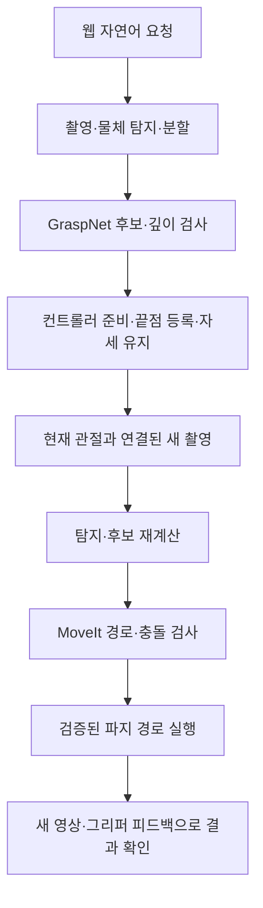

# Pick Station 개발·운영 인계서

> **11/23 실기 지연 위치 확인 및 프로세스 분리:** `붙여넣은 텍스트(3).txt`의 부트 164, `compute:detect` 기록에서 AL 상태 조회 sequence 3705는 전체 104.517 ms, read 0.146 ms, decode wall 89.276 ms / thread CPU 2.062 ms였다. USB 응답 수신 이후 호스트 실행 지연이 큰 구간임을 확인했으며 OS 스케줄링과 같은 프로세스의 GIL 경쟁 중 어느 쪽인지는 확정하지 않았다. 최초 STOP은 tick 1301685, interlock 1301435로 기존 250 ms 만료다.
>
> 기존 RealSense `CameraWorker` 스레드는 웹 제어 프로세스와 GIL을 공유했다. 웹 실기 경로에만 `PickCameraProcess`를 도입하여 SDK를 spawn 자식에서 생성하고 부모는 pipe 수신 스레드에서 원본 이미지·노출 기록을 전달한다. 직렬 포트·제어 입력은 자식에 넘기지 않는다. pipe backpressure로 무한 영상 큐를 만들지 않으며 기존 신선도 검사를 유지한다. 시작/수신 오류는 소유자에게 전달하고 종료 시 자식을 회수한다. 카메라/추론 자식은 허용 CPU가 3개 이상이면 마지막 CPU를 affinity에서 제외하고 nice +5를 시도한다. 적용 실패는 로그에 기록하며 성공한 전용 코어 예약으로 간주하지 않는다. 추론 PyTorch 스레드는 최대 2개다. 150 ms GIL 보유 native 호출을 모사한 테스트에서 부모 루프 갱신, 시각 보존, 오류 전파·자식 회수를 검사했다. 실물 문제의 해결 여부는 아직 재확인 전이다.
>
> 검증: 관련 테스트 **556 passed**. 패키지 `station-c6b260a68a884ac5` 사전점검 **8항목 PASS**, 보고서 `output/pick-kit/station-c6b260a68a884ac5/output/preflight/20261123T125220Z-a22wj30h/report.json`. 이 검증에서 장치 제어는 하지 않았고 Jetson 배포/실기 결과는 아직 없다. 노트북의 기존 `open_pick_station.sh` 한 명령으로 패키지를 배포한다. 새 요청 준비 로그에 `카메라 별도 프로세스 준비 완료`가 있어야 한다.

> **11/23 비활성 통신 부하 비교 완료:** `output/pick-serial-timing/check-EDO5ijYc/report.json`은 `READ_ONLY_PROBE_COMPLETE`, 모드 `unprepared_controller_query_only`, 합성 CPU 프로세스 4개, 장치 동작 명령 0이다. 무부하 223회씩/부하 254회씩 GET_STATE·commission·runtime를 조회했으며 최대 지연은 각각 무부하 1.984/5.773/7.035 ms, 부하 2.103/3.797/6.729 ms다. 총 1,431개 거래에서 50 ms 초과는 없었다. 당시 commission flags/boot_id=0, executor와 관측 루프는 비활성이며 리프트 세션 조회는 생략했다. 따라서 기본 링크의 무응답은 현재 재현되지 않았지만, 실제 GraspNet·RGB-D·관절 관측·리프트 유지 동시 실행에서의 149 ms 지연 원인은 아직 확정할 수 없다. 다음 실기 요청은 최신 거래별 계측의 `transport_before_stop`으로 확인한다. 이 결과를 파지 준비/실물 성공 승인으로 사용하지 않는다.

> **11/23 STOP 미잠금 조회 분기:** `check-kGkFiPWK/report.json`은 HELLO 거래 1.994 ms로 성공했으나 `stop_latched=false`여서 초기 진단 조건에 거절됐다. STOP 해제 이유나 현재 토크 상태는 이 결과로 알 수 없다. 새 진단은 STOP이 없어도 매 반복에서 commissioning flags/boot_id/reason이 모두 0이고 runtime executor_active/settling이 명시적으로 false인 경우에만 `unprepared_controller_query_only`를 허용한다. 이 분기는 리프트/베이스 세션을 생성하지 않고 상태·commission·runtime 조회만 수행한다. 활성/준비된 컨트롤러는 계속 거절하며 상태를 바꾸지 않는다. 관련 검사 **56 passed**. 아직 현장 CPU 부하 비교 결과는 없다.

> **11/23 조회 진단 시작 절차 수정:** `check-fv1Yprfk/report.json`에서 최초 GET_STATE 쓰기 0.113 ms, 수신 처리 402.088 ms, 유효 응답 없음으로 부하 비교 전에 종료됐다. 초기 진단은 binary 모드 유지 상태를 가정하고 `P → HELLO`를 생략했다. 기존 `cached_controller()`와 동일한 통신 모드 확인을 추가했다. `BinaryControl_EnterMode()`는 파서 초기화와 mode 플래그만 설정하며 STOP·토크·부트는 변경하지 않는다. HELLO에서 지원 펌웨어/12관절/STOP 잠금을 확인하며 잠금이 풀려 있으면 조회를 진행하지 않는다. 무응답의 실제 원인이 모드였는지는 새 현장 결과가 필요하다. ASCII 시작/기존 binary 시작 각각에서 STOP 유지·미잠금 거절 및 활성화 명령 부재를 검사했다.

> **11/23 21:12 후보 생성 중 STOP 진단:** 업로드된 `붙여넣은 텍스트(1)(20261123-121641).txt`는 배포 `pick-station-eOVK9V6K`, 요청 `4c2c2656225040858d48a108a86d69d2`, 부트 162의 실제 정지 보고서다. 마지막 정상 갱신의 전체 처리 155.077 ms 중 베이스/리프트 상태 조회가 149.184 ms (`3166.788060116`→`3166.937243876`)였다. 다음 갱신까지의 공백은 12.653 ms다. 최초 STOP tick 89460, interlock 관측 89210으로 250 ms 만료. 후보 생성 후 계획 진입 전이며 실제 파지 전송은 없었다. `execution_phase=preparation`은 당시 단계 표지가 compute 작업에서 갱신되지 않은 표시 문제였다.
>
> 현재 변경: compute 단계 표지를 갱신하고 프로토콜 거래별 lock 대기·write/read/decode wall 시간 및 thread CPU 시간을 최근 256개 기록한다. STOP 확인 트래픽 전에 기록을 복사하여 `transport_before_stop`에 보존한다. 타임아웃·재전송·STOP 해제 동작은 바꾸지 않았다. 별도 `check_pick_serial_timing.sh`는 포트 소유권을 확보한 STOP 상태에서만 조회하고 무부하/합성 CPU 부하를 비교한다. 실제 GraspNet 재현이나 실행 중 실시간 성능 보증은 아니다. 149 ms 지연의 원인이 USB인지 호스트 스케줄링인지는 기존 자료만으로 확정하지 않는다.
>
> 검증: 관련 검사 **512 passed**, 조회 ZIP 구성/인자 파싱/보고서 수신 mock SSH 검사 통과. 패키지 `station-5154a889476d15c4` 사전점검 **8항목 PASS**, 증거 `output/pick-kit/station-5154a889476d15c4/output/preflight/20261123T122607Z-2a8iugxy/report.json`. 작업 환경에서 SSH는 여전히 `Network is unreachable`; 새 계측의 실기 측정 결과는 아직 없다. 노트북에서 `bash ~/Mobile-Bimanual-Home-Assistant-edit/tools/run/check_pick_serial_timing.sh`를 실행하면 별도 웹 재배포나 실물 집기 없이 STOP 상태 조회 보고서를 받을 수 있다.

> **11/23 20:52 실행 진입 STOP 후속:** 사용자 제공 로그에서 리프트는 최상단, STM32 `0x24930`, CRC `3399362976`, 부트 160, 엔코더 1744다. 20:52:27 경로 검증 완료 뒤 20:52:30 실패. `mobile_board.source=1`, 최초 STOP tick 386045, 마지막 interlock 관측 tick 385795로 정확히 250 ms 경과했다. 리프트 fault·모터 읽기 실패는 0이다. 마지막 executor 완료 tick 255930 및 dispatch 60회는 약 130초 전 초기 유지 경로의 기록으로, 실제 집기 완료를 뜻하지 않는다. 현재 자료만으로 지연을 일으킨 호스트 함수는 확정할 수 없다.
>
> 실행 번들 읽기·요청 바인딩 검사는 기존 별도 compute 프로세스에서 유지한다. 추가로 설치 보정 확인·상단 경로 감사·FK/영상 관측 초기화를 보조 작업으로 옮겨 그 동안 실제 상태 갱신을 계속하며, 작업이 끝나면 새 관측으로 리프트 높이와 시작 자세를 다시 검사한다. 실행 의존 모듈은 토크 유지 시작 전에 읽는다. STOP 진단 JSON에는 실행 세부 단계와 최근 160회의 갱신 간격/처리시간을 추가했다. 250 ms 관측 기한·STOP·충돌 검사는 변경하지 않았다. 원격 배포와 실기 재현은 이 작업 환경의 Jetson 네트워크 경로 부재로 아직 확인하지 못했다.
>
> 검증: 관련 테스트 **581 passed**. 350 ms 지연된 보정 감사 중에도 상태 갱신이 이어지고, 그 동안 바뀐 높이/앵커 및 잘못된 보정은 전송 전에 거절하는 회귀 검사 포함. 새 패키지 `station-0c41f732140ad3c2` 사전점검 **8항목 PASS** (`output/pick-kit/station-0c41f732140ad3c2/output/preflight/20261123T120553Z-et0085oq/report.json`). 실물 제어 명령은 보내지 않았다.

> **11/23 대상 모호함 후속 수정 (`rgbd-693`):** 사용자가 제공한 보고서에서 실제 지우개 #0은 점수 0.4382, 상판 위 높이 12.09 mm, 유효 깊이 비율 99.62%로 accepted였다. #1은 점수 0.3057, 깊이 비율 100%지만 `insufficient_mask_depth`였다. `measure()`는 상판에서 3 mm 이상인 점이 50개 미만이어도 이 사유를 반환한다. 기존 신뢰도 우세 조건을 완화하거나 깊이 불량 대상을 버리지 않고, 웹 요청의 명시적 화면 좌우 선택을 기존 `choose_observation()`까지 연결했다. `오른쪽 지우개를 집어줘` → 탐지어 `eraser`, 선택 `right`. 제공된 두 상자·점수·기하 상태로 오른쪽 #0 선택, 왼쪽 #1 요청 시 REOBSERVE, 상자 겹침 시 AMBIGUOUS_TARGET을 검사했다. 이 검사는 원본 RGB-D 재추론이 아니며 현재 로봇에 배포됐다는 뜻도 아니다. 앞으로 후보 보고서에는 마스크 픽셀 수와 상판 분리 후 점 수를 함께 기록한다.
>
> 해당 수정 검증: 관련 검사 **449 passed, 2 skipped**, 패키지 `station-86c4e5fcd407b4ac` 사전점검 **8항목 PASS**. 증거: `output/pick-kit/station-86c4e5fcd407b4ac/output/preflight/20261123T113942Z-rxhy_duv/report.json`. 장치 명령 0. 재배포 후 새 요청에서 위치를 지정해야 하며, 기존 웹 프로세스에는 자동 반영되지 않는다.

> **2026-11-23 재개:** 아래 11/18–19 기록은 당시 상태다. 현재 코드는 명목 TCP 단면 집게, 남은 후보 탐색, 5DOF Cartesian 대안, 하단 관측 후 상승, 최상단 단일 촬영 시험까지 포함한다. 오늘은 웹과 저장 장면 검사 도구의 계획 설정 불일치를 수정했다. `tools/lib/pick_planning.py`를 함께 사용하고, 요청의 `checked/planning-options.json`에 설정을 기록한다. 이전 검사 도구는 진입 여유 4 mm·추가 닫힘 0이었지만 웹은 전체 여유 10 mm·고정 측 6 mm·추가 닫힘 50 raw였다. 웹의 기존 수치나 충돌 판정은 변경하지 않았다.
>
> 관련 회귀 검사 **451 passed**. 실제 Grounding DINO/SAM/GraspNet 저장 영상 추론 2회(각 후보 32개), 웹 HTTP, 상주 MoveIt, 충돌 계획을 포함한 사전점검 **8항목 PASS**. 실기 성공을 뜻하지 않는다. 사전점검 증거는 `output/pick-kit/station-a331616dc09ee492/output/preflight/20261123T111742Z-8elm32st/report.json`. 이후 사용 설명서만 수정한 최종 패키지는 `station-266b62016ebea2fc`이며 SHA256 검사를 통과했다.
>
> 11/19 저장 장면 `latest-prepared-at-top.json` (`rgbd-666`)을 현재 웹 설정으로 실제 MoveIt 재계획했다. **NO_COMPLETE_ROUTE**, 7,575 상태 검사, 66.2초. 바인딩된 후보 24개 중 균형 거절 3개, 접근 IK 거절 1개, 물체와 관측 장애물의 닫힘 충돌 20개다. 처음 8개 이후에도 탐색했으며 과거의 집게 간격 혼용 오류와는 구분된다. 이 저장 파일은 원본 픽셀에서 최신 장면 분할을 다시 만든 결과가 아니므로 새 촬영도 똑같이 실패한다고 단정하지 않는다. 근거: `output/pick-validation-20261123/regression/01-rgbd-666/planning/report.json`. 실행 번들은 생성하지 않았다.
>
> 후속 저장 장면 `pick-final-candidate-20261120/prepared-resumed.json` (`rgbd-687`)은 같은 웹 설정으로 **OFFLINE_ROUTE_FOUND / PASSED**. 선택 후보 `rgbd-687:3:reversed`, 계획 상태 525개, 전송 좌표 검증 상태 1,098개, 별도 장애물 거절 및 정상·실패 모의 시나리오 10개 통과, 20.0초. 근거: `output/pick-validation-20261123-resumed/regression-summary.json` 및 `regression/01-rgbd-687/proof.json`. 이 재현에서는 하드웨어 명령이 0이며 과거 장면의 결과를 현재 로봇 실행 승인으로 재사용하지 않는다.
>
> 사용자 확인: 로봇 연결됨, 리프트 **최하단**, SSH `hyper@192.168.35.2`. 이 작업 환경의 SSH 응답은 **Network is unreachable**이므로 오늘 원격 배포·현재 보드 조회·모터 실행은 하지 않았다. 웹에서는 **하단 관측 → 최상단 상승 → 집기**를 선택해야 한다. 최상단 팔 시험과 구분한다. 현재 설치된 펌웨어/CRC와 실기 파지 성공은 아직 확인해야 한다. 최신 사용법은 [튜토리얼의 2026-11-23 절](pick_station_tutorial.md)을 따른다.

> **11/19 저녁 IK 원인 확인·수정 (`pick-station-4bbd797a1074e037`):** 마지막 `rgbd-666` 후보를 재현했다. 중심 검사 후 남은 26개는 모두 위치·관절 한계가 아닌 Cartesian 자세 2도 조건에서 탈락했다. 수직 tabletop 접근/상승에만 5도 변화를 허용하고, 특이점 근처에서는 Cartesian 간격을 나눠 연속 경로를 찾는다. 관절 변화 한계·접촉 단면·중심·손가락 기울기·충돌 검사는 유지한다. 24개가 접근/상승 IK와 접촉 검사를 통과했으나 실물 성공이 아니다.
>
> 실제 로컬 MoveIt에서 우선 후보 8개는 관측 장애물/그리퍼 겹침 4개, 과거 상단 보정 자세 범위 4개로 완성 경로가 없었다. 보정 적용 범위 실패를 물리적 도달 불가와 구분해 표시한다. 이 범위는 확대하지 않았다. 대기 중 통신 오류·결과 저장 실패 뒤 초기화가 막히는 문제도 수정했다. 관련 회귀 검사 559개 통과. 새 웹은 준비 완료이며 이번 작업에서 모터 명령은 보내지 않았다.
>
> 상세 근거: 데스크톱 `SO101-Can-Towel-Manipulation/output/pick-ik-review-20261119/summary.json`, `latest-replay.json`, `native-moveit/report.json`. 아래 기록은 당시 상태를 보존한 이력이다.


> **11/19 코드 후속 변경:** 기본 흐름을 하단 관측 → 엔코더 기준 상단 상승 → 도착 자세로 계획하는 경로로 추가했다. 물체 좌표·RGB-D·후보는 하단 관측을 보존한다. `lift_geometry.measured.json`의 전체 행정 30,717 counts를 사용자 확인에 따라 재사용하며, 제어기 전달값 654588과 팔 계획의 유효 높이 0.630 m를 분리한다. 새 프로필 CRC는 3399362976이고 펌웨어 빌드는 완료했으나 **설치·실기 검증은 하지 않았다**. 기존 CRC 2696088964는 상승 전 거절한다.
>
> 집게는 명시적인 CAD TCP 단면 모드로 계산·검사·명령을 통일했다(새 실측 보정 아님). 첫 8개 실패 후 남은 후보도 탐색한다. 연속적으로 180도 이상 회전한 경로를 분기 급변으로 오인하던 검사를 수정하고, 실제 인접 샘플 급변·관절 한계·wire seam 검사는 유지했다. 11/18 원본 장면의 실제 MoveIt 재계획에서 접촉 단면 오류와 분기 급변 오류는 0건으로 줄었지만, **상판 충돌 6건과 물체/관측 장애물 충돌 12건으로 완성 경로는 아직 없다**. 이 충돌을 무시하도록 바꾸지 않았다. 아래는 변경 전 실행 이력이다.

작성 기준: 2026년 11월 18일, 한국 시간 23:03 실물 실행 로그와 이후 경로 실패 보고서 분석까지.

이 문서는 이번 대화에서 진행한 작업을 다음 개발자와 운영자가 이어받기 위한 기록이다. **현재 웹 실행은 물체 탐지, GraspNet 후보 생성, 컨트롤러 준비, MoveIt 경로 검사까지 도달했다. 해당 웹 요청의 실제 파지 성공은 아직 확인되지 않았다.** 마지막 실패는 `NO_COMPLETE_ROUTE`이며, 집게 접촉 단면 기준 혼용과 후보 탐색 범위 등 아래 미해결 항목이 남아 있다.

## 1. 목표와 현재 범위

사용자가 웹에 “리모컨을 집어줘”처럼 자연어로 요청하면 새 RGB-D 촬영, 물체 탐지·분할, GraspNet 파지 자세 계산, SO-ARM101 적용 검사, 경로 계획, 실제 파지, 결과 확인을 한 요청으로 진행한다. 리모컨은 현재 실험 대상이며, 물체 종류를 리모컨으로 고정하는 시스템은 아니다.

현재 실기 경로는 **고정 베이스·고정 리프트 기준·왼팔 집기**에 집중한다. 양팔 동시 파지, 자유로운 리프트 높이 변경, 베이스 자율 재배치, 파지 후 놓기와 빈손 자동 복귀까지 완성된 상태로 해석하면 안 된다. 다른 물체를 요청할 수 있지만 물체마다 탐지·깊이·집게 폭·도달성·충돌 조건을 통과해야 한다.

| 구분 | 현재 상태 |
|---|---|
| 웹에서 자연어 요청 및 단계 표시 | 구현, 사용자 실행 확인 |
| Grounding DINO + SAM 탐지·분할 | 리모컨 실측 영상에서 확인 |
| 실제 GraspNet 추론 | 연결 완료, 후보 생성 확인 |
| 광각 깊이 부족 시 근거리 재촬영 | 사용자 로그에서 확인 |
| 컨트롤러 준비·현재 자세 유지·최상단 등록 | 마지막 요청에서 통과 |
| MoveIt 경로 계획·충돌 검사 | 실행됨, 마지막 결과는 실패 |
| 실제 파지 실행 및 사후 검증 | 코드 경로 존재, 이번 웹 요청에서는 진입 전 거절 |
| 현재 실패 원인 수정 | 원인 분석까지 완료. 집게 기준·후보 탐색 수정은 아직 미적용 |

## 2. 인수 시 먼저 확인할 작업본

| 항목 | 확인한 값 |
|---|---|
| 노트북 저장소 | `/home/an-hyeonseo/Mobile-Bimanual-Home-Assistant-edit` |
| 로컬 브랜치 | `work/local-edits` |
| Git HEAD | `d903bd6874e168dd98be02b664a1cb5823b218fd` |
| 현재 패키지 링크 | `output/pick-kit/current` |
| 현재 패키지 실제 폴더 | `output/pick-kit/station-aeb845c4adf7f469` |
| 기록된 Jetson 배포 폴더 | `/home/hyper/robot/releases/pick-station-Y8ryDxjr` |
| Jetson SSH | `hyper@192.168.35.2` |
| 통합 제어기 | STM32 `0x2492e`, 프로필 CRC32 `2696088964` |
| 마지막 정상 최상단 등록 로그 | raw `1906`, boot `117` |

**작업 트리에 다수의 수정 파일과 새 파일이 있으며, 위 HEAD만으로 이번 구현을 복원할 수 없다.** GitHub에 반영 완료한 상태가 아니다. 인계 전에 `git status --short`로 로컬 변경을 보존하고, 기존 작업을 덮어쓰는 reset/checkout을 하지 않는다. 배포 폴더명과 raw·boot 값은 다음 실행에서 바뀔 수 있다.

모델·메시 등 로컬 자산은 Git 저장소만으로 모두 재현되지 않을 수 있다. 기존 추론 환경과 준비된 패키지도 함께 보존한다.

## 3. 일반 운영 — 웹 한 번으로 실행

### 노트북에서 시작

```bash
bash ~/Mobile-Bimanual-Home-Assistant-edit/tools/run/open_pick_station.sh
```

실행기는 패키지를 생성하고, 사용 가능한 웹 포트를 선택하고, 필요한 경우 Jetson으로 전송한 뒤 사전점검을 수행한다. 이후 SSH 터널과 Jetson 웹 서버를 연결하고 브라우저를 연다. 설치되어 있으면 노트북의 자연어 번역 서버도 연결한다.

터미널에 출력된 `Pick Station http://127.0.0.1:포트` 주소를 사용한다. 기본 포트는 18768이며 충돌하면 18769–18788 중 양쪽에서 사용 가능한 포트를 선택한다. 과거에 18770을 사용했어도 항상 같은 주소라고 가정하지 않는다. **서버 터미널은 열어 둔다.**

패키지는 약 894 MB였고, 현장 전송은 약 2분이 걸렸다. 같은 버전은 기존 릴리스를 재사용할 수 있지만 코드 변경으로 패키지가 바뀌면 새로 전송할 수 있다.

### 웹 조작

1. 프로그램 준비 완료와 모델 표시 `Grounding DINO · SAM · GraspNet · MoveIt`을 확인한다.
2. 현재 물리 상태에 맞는 작업을 선택한다.
3. 실물 파지에서는 실제 리프트 끝점, 받침, 양팔 지지, 빈 그리퍼 확인 항목을 체크한다.
4. `리모컨을 집어줘` 등 요청을 입력하고 **집기 요청**을 누른다.
5. 진행 기록과 최종 결과를 확인한다. 경로 검사까지 통과하면 실제 팔 동작으로 이어진다.

| 웹 작업 | 의미 |
|---|---|
| 최상단 · 실물 파지 | 확인한 기계적 최상단을 등록하고 왼팔 파지 절차 진행 |
| 최상단 · 카메라 검사 | 실제 카메라로 물체와 후보를 확인. 팔 동작 없이 검사 |
| 최하단 · 실물 파지 | 실제 최하단 확인과 해당 기준 파일을 사용한 실행 경로 |

작업 선택과 확인 체크는 리프트를 그 위치로 이동시키는 명령이 아니다. 실제 상태를 확인하고 기준을 등록하기 위한 입력이다.

### 물체 요청의 범위

알려진 한국어 물체명·색상은 내장 어휘로 처리하고, 새로운 한국어 표현은 설치된 Qwen 번역기를 사용한다. 영어 물체명도 사용할 수 있다. 해석된 탐지어가 의도한 물체와 맞는지 웹에서 확인한다. “계산기 오른쪽에 있는 물체” 같은 상대 위치 조건이나 복수 작업 전체를 지원한다고 가정하지 않는다.

### 종료와 다시 시작

웹의 **작업 중단**은 중단 요청이다. 실제 정지 확인 여부는 결과와 제어기 관측으로 확인한다. 서버 터미널의 `Ctrl+C`도 종료 절차를 시작한다. 자세 유지가 시작된 후에는 STOP 상태에서도 토크가 남을 수 있다.

코드 수정본을 적용하려면 현재 실행기를 종료한 뒤 위 `open_pick_station.sh`를 다시 실행한다. 웹 새로고침만으로 Jetson의 Python 코드가 갱신되지는 않는다. 토크·STOP·fault 복구가 필요한 경우에는 해당 상태를 먼저 확인한다.

## 4. 처리 구조



최상단 요청은 먼저 토크를 켜지 않은 상태에서 광각 영상과 후보를 검사한다. 깊이가 부족하면 근거리로 재촬영한다. 장치 준비가 끝나면 **유지 중인 실제 관절·리프트 관측과 연결된 새 영상**을 다시 촬영해 실행용 후보를 만든다. 앞의 카메라 검사 결과를 그대로 팔에 보내지 않는다.

초기 사전 검사도 웹 상태상 촬영 단계 안에 포함될 수 있어, 로그에 `GraspNet 계산`이 나온 뒤 정식 `파지 후보 생성 시작`이 다시 나타날 수 있다. 사전 관측과 실행용 관측의 역할이 다르다.

탐지·분할·GraspNet 모델과 MoveIt 프로세스를 가능한 한 상주시킨다. 매 요청마다 새 장면과 관측을 사용하면서 모델 로딩과 계획 프로세스 시작 비용을 줄이는 구조다.

## 5. 주요 구현 파일

경로는 저장소 루트 기준이다.

| 파일 | 역할 |
|---|---|
| `tools/run/open_pick_station.sh` | 노트북의 일반 진입점. 패키징·배포·터널·웹 시작 |
| `tools/setup/package_pick_station.py` | 실행 코드·자산을 패키징하고 `SHA256SUMS` 생성 |
| `tools/setup/pick_station_ports.py` | 기존 동일 버전 서버와 사용 가능한 포트 확인 |
| `tools/run/stage_pick_station.sh` | Jetson 새 릴리스 복사 및 사전점검 |
| `tools/run/pick_kit.sh` | 패키지 안의 환경 선택과 모드 실행 |
| `tools/run/pick_service.py` | 웹 서비스 CLI와 옵션 |
| `ros2_ws/src/home_robot_tasks/home_robot_tasks/pick_service.py` | 요청 상태, 단계 대기, 취소, 결과 기록 |
| 같은 디렉터리의 `pick_web.py`, `web/pick_monitor.html` | HTTP API와 웹 화면 |
| `pick_web_backend.py` | 웹 작업 선택, 광각→근거리 재촬영, 실물 준비 연결 |
| `pick_backend.py`, `pick_worker.py` | 단계별 실행과 별도 추론 작업자 |
| `tools/lib/pick_compute.py` | 탐지·후보·계획·실행 전 검증 연결 |
| `pick_hardware.py` | 단일 제어기 소유, 끝점 등록, 자세 유지, 실물 실행 |
| `pick_capture.py`, `unified_carry_inputs.py` | 영상과 관절·리프트 관측 연결, 상태 신선도 검사 |
| `pick_calibration.py` | 보정 파일 검증, 최상단 모델과 세션 기준 검사 |
| `pick_rgbd_verification.py` | 사후 RGB-D와 그리퍼 관측을 이용한 결과 판단 |
| `home_perception/grasp/graspnet.py`, `pointnet2_cpu.py` | GraspNet 추론과 CPU 연산 경로 |
| `home_perception/grasp/graspnet_assets.py` | GraspNet 소스·체크포인트 검증 |
| `tools/diagnostics/plan_capture_carry.py` | 후보 바인딩, 관측 장면, MoveIt 계획 보고서 |
| `carry_binding.py`, `carry_planning.py`, `carry_moveit.py` | SO-ARM101 후보 연결, 경로 선택, 충돌·접촉 검사 |
| `installed_jaw.py`, `so101_jaw.py` | 실측 집게 환산과 CAD 단면 모델. 현재 실패 분석의 핵심 |

마지막 다섯 개의 단축 파일명은 특별한 언급이 없으면 `ros2_ws/src/home_robot_tasks/home_robot_tasks/` 아래에 있다.

## 6. 모델·실행 환경

| 항목 | 현재 연결 |
|---|---|
| 탐지 | `IDEA-Research/grounding-dino-tiny` |
| 분할 | `facebook/sam2.1-hiera-tiny` |
| 파지 후보 | GraspNet baseline, RealSense 체크포인트 |
| GraspNet 소스 리비전 | `280c215129f759ed8649cb4e89fc5dfee55f4f80` |
| 체크포인트 SHA256 | `60680087c61cba2b6791614fef1519071e294f6dcaf99b3f581bb95f7c51a868` |
| 웹의 추론 설정 | `--device cpu --candidate-source graspnet` |
| Jetson 추론 Python | `/home/hyper/realsense-grounding/.venv/bin/python` |
| Jetson 제어 환경 | `/home/hyper/robot/shared/venvs/s4-jazzy` |
| Jetson ROS 환경 | `/home/hyper/robot/shared/runtime/s4-jazzy/env.sh` |
| 노트북 추론 Python | `~/Documents/GitHub/SO101-Can-Towel-Manipulation/.venv-realsense/bin/python` |
| 번역 서버 | 노트북의 기존 Qwen3-4B GGUF·llama-server, 포트 18767 |

현장에서 CUDA 환경 호환 문제를 피하기 위해 CPU 추론 경로를 사용한다. `torch.cross`의 `dim` 경고나 SAM 모델 종류 경고가 출력됐지만, 이후 실제 탐지·후보 생성이 진행됐다. 해당 경고만으로 이번 경로 실패 원인이라고 판단하지 않는다.

**모드별 기본값 차이에 주의한다.** 현재 `pick_kit.sh web`과 `inspect-target`은 GraspNet을 명시한다. 기존 `pick_kit.sh plan-only`와 `pick`은 최하단 전용이며 `--candidate-source so101`을 사용한다. GraspNet 웹 실험을 이어갈 때 일반 진입점은 `open_pick_station.sh`다. `demo`는 실제 모델·장치를 사용하는 검증이 아니다.

## 7. 캘리브레이션 반영 내역과 적용 범위

원본 브랜치는 [yeoeun/extrinsic-calibration](https://github.com/Anhyeonseo/Mobile-Bimanual-Home-Assistant/tree/yeoeun/extrinsic-calibration)이다. 이번 작업에서 기준으로 고정한 리비전은 `05b1ae603e6b1fbe57a99992db17ba85ac86e7fb`이다. 이후 upstream 변경 여부는 별도로 비교해야 한다.

다음 파일들을 적용하고 `pick_calibration.verify_installed()`에서 고정된 SHA256으로 확인한다.

- `config/home_assistant/measured_calibration.development.json`
- `config/home_assistant/s2_coordinates.development.json`
- `config/home_assistant/s2_coordinates.wide.development.json`
- `config/home_assistant/camera_height.calibrated.json`
- `config/home_assistant/left_pad_gap.observed.json`

카메라 변환, 팔 관절 영점·장착 위치, 리프트 환산, 광각/근거리 프로필과 왼쪽 집게 측정 기록을 연결한다. 마지막 근거리 실행의 보정 ID는 `s2-dev-e8058172f936cf6c5058fb61`이었다.

### 최상단 630 mm의 의미

`TOP_MODEL_M = 0.630`은 현장 기록의 **기계적 최상단·왼팔을 편 자세·약 735 mm 상판** 조건에서 사용하는 유효 계획 높이다. 제어기의 등록 높이와 별도로 계획에 적용한다. 리프트의 모든 높이와 모든 팔 자세를 검증한 일반 보정값이 아니다. 원본 기록에는 팔을 접은 자세의 오차와 행정 재측정 필요성이 남아 있다.

해당 조건에서의 원본 지우개 파지 성공 사례를 이번 웹의 리모컨 파지 성공으로 혼동하지 않는다. 현재 코드는 상판 높이·수평 조건, 편 팔 경로 범위와 실측 오차를 고려한 상판 간격도 검사한다.

### 이번에 수정한 최상단 raw 판정

기존 코드가 현장 관측 raw `1727–1882`를 고정 허용 범위로 사용해, 사용자 측정 `1979`에서 거절됐다. 이 숫자는 과거 관측 범위이며, 한 바퀴 안의 엔코더 raw만으로 절대 물리 높이를 판정할 수 없다.

수정본은 웹에서 사용자가 실제 기계적 최상단을 확인한 요청에 대해 다음을 수행한다.

1. 토크 OFF 상태의 정지 관측과 유효 raw 범위 확인.
2. 현재 자세 유지 및 신선한 정지 관측 후 상단 등록.
3. raw·부트 ID·리프트 세션·보정 ID를 이번 기준으로 보존.
4. 준비 중 및 등록 이후 위치 변화, 제어기 재시작, 세션 변경, fault·상태 신선도 확인.
5. raw 기준 2 mm 초과 변화와 등록 높이 이탈 등을 거절.

기준 이름은 `operator_supported_top_straight_arm_20261118_v2`다. 이 변경 후 사용자 로그에서 raw `1906`, boot `117`의 등록과 장치 준비가 통과했다. **raw 값을 새 상수로 바꾸거나 과거 범위에 맞추려고 기구를 움직이는 방식으로 복구하지 않는다.** 사용자의 실제 끝점 확인은 여전히 필요하다.

## 8. 시간 제한·SSH·토크 관련 처리

### 시간 제한

현재 웹은 `--stage-timeout-seconds 0`으로 단계 전체 처리시간 제한을 두지 않는다. 오래 걸리는 CPU 추론·계획을 계속 기다리면서 취소와 장치 상태 검사를 수행한다. 다른 모드의 기본 단계 제한은 300초다.

센서 신선도, 제어기 lease, 정지 확인, 자세 유지 확인 같은 개별 장치 제한은 유지한다. `check_pick_hardware.sh`의 원격 진단에는 별도 `timeout 60`이 남아 있다. 이 진단 제한과 웹의 처리시간 제한을 혼동하지 않는다.

### SSH 메시지

| 메시지 | 의미와 확인 대상 |
|---|---|
| `channel … connect failed: Connection refused` | SSH 자체가 끊겼다는 뜻으로 단정하지 않는다. 포워딩 목적지 웹 서버가 아직 뜨지 않았거나 종료됐을 수 있다. 서버 시작 로그와 선택한 포트를 확인한다. |
| `Address already in use` | 로컬 포트 충돌. 현재 런처는 사용 가능한 포트를 자동 선택한다. 출력 주소를 따른다. |
| `Connection … closed` 직후 웹 시작 안내 | 배포 사전점검용 SSH 세션이 종료된 것일 수 있다. 이후 웹 세션의 상태와 구분한다. |

### STOP과 토크

이번 장비에서는 STOP 상태와 토크 OFF를 동일하게 취급하면 안 된다. STM 리셋 후에도 서보 토크가 남은 실제 관측이 있었다. 부팅·정지 해제, 토크 해제, 자세 유지, 경로 실행은 서로 다른 동작이다.

이전 수동 복구에서 지원된 해제 절차가 `SUPPORTED_BOOT_RELEASED`, `final_all_torque_off: true`, `stationary_verified: true`를 반환한 기록이 있다. 이를 모든 부트·펌웨어에서 임의로 재사용 가능한 일반 명령으로 배포하지 않는다. 기존 릴리스와 현재 패키지의 펌웨어 지원 차이가 있었다. 수동 복구가 필요하면 현재 보드와 지원 스크립트를 확인하고, 빈 팔·받침 상태에서 수행한다.

`prepare_unified_controller.py --output`에는 **아직 존재하지 않는 파일 경로**가 필요하다. `mktemp`로 이미 만든 파일을 주면 `new output required`가 발생한다. 진단 스크립트 실행 시 `mktemp -d`로 폴더를 만들고 그 안의 새 `report.json` 경로를 쓰는 방식이 맞다.

## 9. 마지막 실물 실행 기록

2026-11-18 한국 시간, 요청 대상 `remote control`.

| 시각 | 관측 |
|---|---|
| 23:00:42 | 보정 확인, 모델 준비 |
| 23:00:53 | 새 요청 시작 |
| 23:01:21 | 광각 유효 깊이 37%, 근거리 재촬영 |
| 23:01:54 | 근거리 유효 깊이 100%, 장치 준비 시작 |
| 23:01:56 | 토크 OFF 엔코더 1906 확인 |
| 23:02:03 | 이번 세션 최상단 등록, boot 117, 유지 준비 완료, MoveIt 준비 |
| 23:02:19 | 실행용 물체 탐지 시작 |
| 23:03:00 | 파지 후보 생성 시작 |
| 23:03:12 | 경로 계획·검사 시작 |
| 23:03:55 | `no executable route: NO_COMPLETE_ROUTE` |

보고서의 capture ID는 `rgbd-674`다. 초기 로봇 상태의 충돌 검사는 `initial_state_valid: true`, `initial_contacts: []`였다. 관측 장면 박스 23,480개, 검사한 상태 1,117개가 기록됐다. 1,117은 성공 경로 수나 파지 시도 수가 아니다.

보고서의 `hardware_commands: 0`은 **오프라인 경로 계획 함수의 기록**이다. 이 요청 전체에는 이미 장치 준비·자세 유지가 포함되어 있으므로 “요청 전체에서 모터 명령이 0개였다”는 의미로 확대하면 안 된다. 파지 경로 전송 단계에는 진입하지 않았다.

## 10. 현재 실패 원인 — 분석 완료, 수정 미적용

### 후보 수를 정확히 읽는 방법

32개 원 후보에 손가락 방향 반전까지 고려한 64개 바인딩 시도 중 14개가 실패하고, 50개가 로봇 후보로 연결됐다. 이 50개 중 32개가 균형 정책에서 제외되어 18개가 남았고, 기본 예산에 따라 8개만 경로 검사를 수행했다. **나머지 10개는 해당 실행에서 경로 미검사**다.

| 분류 | 개수 | 보고서 근거 |
|---|---:|---|
| 균형 정책에서 제외 | 32 | `CONTACT_TOO_FAR_FROM_PAYLOAD_CENTER` |
| 집게 접촉 기하 불일치 | 3 | `fixed/moving finger contact binding differs from observed section` |
| 관절 경로의 급격한 변화 | 3 | `large joint branch change; no encoder wrapping allowed` |
| 집게와 상판 충돌 | 2 | 집게 링크와 `capture_support` 접촉 |
| 남았지만 경로 미검사 | 10 | 18개 중 기본 `maximum_grasps=8`만 검사 |

### 집게 단면 기준의 혼용

`carry_binding.py`는 `InstalledLeftJaw`의 **실측 앞쪽 접촉면** 곡선으로 raw를 만들고, `fixed_contact_review()`는 같은 raw에서 얻은 모델 각도를 `StockJaw`의 **공식 TCP 단면** 간격으로 다시 평가한다. CAD의 해당 단면은 고정 손가락 끝에서 약 6.298 mm 안쪽이다. 서로 다른 단면의 간격을 같은 폭처럼 사용하는 경로다.

리모컨 단면 폭 약 43.265 mm에서 로컬 코드로 다음 수치를 재현했다.

| 목적 | raw | 실측 앞쪽 간격 | CAD TCP 단면 간격 |
|---|---:|---:|---:|
| 물체 폭에 대응하는 유지 기하 | 2243 | 43.378 mm | 38.392 mm |
| 폭에 4 mm 여유를 더한 진입 | 2272 | 47.297 mm | 41.896 mm |

따라서 검사에서는 이동 손가락 접촉 오차 약 −4.87 mm, 진입 여유 약 −1.37 mm로 계산돼 거절됐다. 이는 단순히 허용 오차를 늘려 해결할 문제가 아니다. **물체 접촉 깊이·TCP 위치·개방량·접촉 판정·충돌 모델·실제 raw 명령을 같은 접촉 단면 정의로 연결해야 한다.** 앞쪽 측정값을 CAD 안쪽 측정값으로 바꿔 부르거나, 명목 CAD 곡선을 실측 보정이라고 간주하면 안 된다.

### 다른 탈락 이유

- 상판 충돌 후보 2개는 명목 모델에서 약 0.008–0.248 mm의 침투가 기록됐다. 작은 수치라는 이유로 실제 여유가 있다고 판정하거나 충돌 검사를 끄지 않는다. 파지 높이·삽입 깊이·관측 평면·손가락 전체 형상을 함께 확인한다.
- 경로 분기 변화 후보 3개는 시작 관절에서 연속된 해로 이어지는지 확인해야 한다. 엔코더 wrapping을 허용하는 식으로 통과시키지 않는다. 같은 관절 한계와 충돌 조건에서 연속 IK 또는 다른 seed를 검토한다.
- 균형 검사는 실제 질량중심 측정이 아니라 관측 기하 중심의 대리 지표다. 보고서에도 `physical_balance_validated: false`가 기록된다. 제외 개수만 보고 실제로 떨어질 물체가 32개라고 해석하지 않는다.
- `REPOSITION_BASE_AND_REOBSERVE`는 현재 코드가 계획 실패 시 붙이는 일반 후속 안내다. 이 요청의 베이스 위치가 원인임을 확정한 진단도, 베이스 이동 명령도 아니다.

## 11. 다음 개발자가 할 작업

1. **집게 접촉 단면부터 정합성을 맞춘다.** 위 raw와 간격을 회귀 사례로 사용한다. `carry_binding.py`, `installed_jaw.py`, `so101_jaw.py`, `carry_planning.fixed_contact_review()`, `carry_program.compile_program()` 및 실행 전 `validate_native()`를 함께 검토한다. 어느 한 검사의 숫자만 바꾸지 않는다.
2. **실패 후 남은 후보를 검사하도록 탐색 정책을 정리한다.** 첫 완성 경로가 나오면 중단하는 동작은 유지하면서, 현재의 8개 한도가 남은 후보를 어떻게 잘라내는지 보고서에 표시한다. 현재 CLI는 `--maximum-grasps` 1–32를 허용하지만 표준 웹 런처는 기본 8을 사용한다. 이 문서 작성 시 자동 확장 수정은 하지 않았다.
3. **관절 분기 실패를 재현한다.** 연속적인 대체 경로가 있는지 검사하되 관절 제한과 중간 충돌 검사를 유지한다.
4. **원본 촬영으로 오프라인 재계획한다.** 보고서 JSON만으로는 RGB-D·준비 후보·장면·정확한 모델 전체를 복원할 수 없다. 해당 요청 폴더 전체를 확보한다.
5. **웹 실패 메시지를 구체화한다.** `NO_COMPLETE_ROUTE` 아래에 후보 수, 실제 검사 수, 미검사 수, 균형/IK/충돌/접촉별 개수를 표시하면 반복적으로 JSON을 전달할 필요가 줄어든다. 현재 이 개선은 미구현이다.
6. 오프라인 경로와 실행 전 검증을 통과한 다음 같은 보정·신선한 촬영으로 현장에서 재시험한다. 최상단의 편 팔·상판 조건 등 후속 검사도 있어 집게 폭 수정만으로 최종 성공이 보장되지는 않는다.

## 12. 결과·로그 확인

웹 관측 이미지 아래의 산출물 링크를 사용한다. `경로 계획 거절 근거`는 실패 보고서, `현재 촬영에 연결된 파지 후보`는 준비 후보, `촬영 시 관절·리프트 관측`은 영상 시점의 제어기 근거다.

일반적인 출력 구조는 다음과 같다. 실제 실행 폴더명과 요청 ID는 매번 달라진다.

```text
<Jetson release>/output/pick-station/<실행 폴더>/<요청 ID>/
  wide/ 또는 near/              # 장치 준비 전 검사 영상·후보
  <capture_id>/                 # 실제 자세 유지 중 촬영
    color.png
    depth_aligned.png
    metadata.json
    robot_capture.json
  prepared.json                 # 실행용 준비 후보
  checked/planning/report.json  # 후보별 경로 검사와 실패 근거
  checked/proof/                # 경로 확보 후 실행 전 검증
  checked/bundle/               # 검증 통과 후 실행 묶음
```

JSON 뷰어의 접힌 표를 복사하면 `{…}`만 남을 수 있다. 인계·디버깅에는 원본 JSON 파일을 보존한다. 특히 `binding_failures`, `plan.failures`, `initial_contacts`, 후보별 `jaw_preview`를 포함해야 한다.

| 결과 | 해석 |
|---|---|
| `OFFLINE_PREFLIGHT_PASSED` | 파일·환경·오프라인 검사 통과. 실제 파지 성공 아님 |
| `CAMERA_CANDIDATES_ONLY` / `OBSERVED_ONLY` | 카메라 후보 확인. 실행 경로 승인 아님 |
| `PLANNED_ONLY` | 실행 전 계획 검사 완료. 파지 경로 미전송 |
| `NO_COMPLETE_ROUTE` | 검사한 후보·탐색 범위에서 완성 경로를 얻지 못함 |
| `UNVERIFIED` | 물체 파지를 확정할 관측이 부족함 |
| `STOP_UNCONFIRMED` | 정지 완료 확인이 남아 있음 |
| `SUCCEEDED` + `physical_success: true` | 실행기의 사후 관측 기준을 통과한 성공. 이번 마지막 요청에는 없음 |

## 13. 개발·진단 명령 모음

일반 사용자는 3절의 웹 시작 명령을 사용한다. 아래는 개발·운영 진단용이다.

### 패키지만 생성·무결성 확인 — 노트북

```bash
cd ~/Mobile-Bimanual-Home-Assistant-edit
python3 tools/setup/package_pick_station.py
cd output/pick-kit/current
sha256sum --quiet -c SHA256SUMS
```

패키지 내부를 직접 수정하면 무결성 검사와 재현성이 깨진다. 저장소 원본을 수정하고 재패키징한다.

### 배포·사전점검 — 노트북

```bash
cd ~/Mobile-Bimanual-Home-Assistant-edit
python3 tools/setup/package_pick_station.py
bash tools/run/stage_pick_station.sh --check-hardware
```

`stage_pick_station.sh` 단독 실행은 기존 `output/pick-kit/current`를 사용하므로, 코드 변경 직후에는 위처럼 먼저 패키징한다. 일반 `open_pick_station.sh`는 패키징을 포함한다.

### 상태 및 필요 시 카메라 촬영 — 노트북

웹의 활성 제어·촬영과 장치 점유가 겹치지 않는 진단 시점에 사용한다.

```bash
cd ~/Mobile-Bimanual-Home-Assistant-edit/output/pick-kit/current
pick_dir=$(cat output/last-jetson-release)
bash tools/run/check_pick_hardware.sh --root "$pick_dir"
# 카메라 진단 촬영도 필요할 때만
bash tools/run/check_pick_hardware.sh --root "$pick_dir" --capture
```

이 진단의 기본 Python과 웹의 추론 Python은 다를 수 있다. 과거 `MISSING_MODULES: torch, torchvision, transformers`가 나타난 제어용 환경의 진단만으로 웹 추론 환경에도 모델이 없다고 판단하지 않는다. 웹 시작 로그의 실제 Python과 `pick_kit.sh env` 결과를 함께 확인한다.

### 저장 촬영의 물체·후보 검사 — 노트북

```bash
cd ~/Mobile-Bimanual-Home-Assistant-edit/output/pick-kit/current
bash tools/run/pick_kit.sh inspect-target /실제/근거리/촬영폴더 '리모컨을 집어줘'
```

위 촬영폴더는 실제 경로로 바꾼다. 이 명령은 저장 영상의 모델 검사용이며 새 촬영이나 파지 명령이 아니다.

### 관련 회귀 검사 — 노트북 저장소

```bash
cd ~/Mobile-Bimanual-Home-Assistant-edit
source /opt/ros/jazzy/setup.bash
export PYTHONPATH="$PWD:$PWD/ros2_ws/src/home_robot_tasks:$PWD/ros2_ws/src/so101_arm_bridge:$PYTHONPATH"
python3 -m pytest -q \
  tests/test_pick_web_calibration.py \
  tests/test_unified_carry_inputs.py \
  tests/test_pick_pipeline.py \
  tests/test_pick_service.py \
  tests/test_pick_kit_environment.py \
  tests/test_pick_monitor.py \
  tests/test_pick_calibration_install.py \
  tests/test_measured_calibration.py \
  tests/test_unified_commissioning.py
```

최상단 기준 수정 후 위 검사에서 **231 passed**를 확인했고, 현재 패키지의 SHA256 검사도 통과했다. 이 수치는 당시 회귀 검사 결과이며 로봇의 파지 성공률이 아니다. 집게 기준 혼용에 대한 수정·재시험 결과는 아직 없다.

## 14. 증거와 관련 문서

- [기존 웹·CLI 사용 설명](pick_station_tutorial.md) — 일부 앞부분에는 이전 실행·이전 raw 제한·별도 CLI 배포 경로가 남아 있다. 이번 웹의 최신 상태는 본 인계서와 현재 코드를 기준으로 구분한다.
- [보정 적용 기록](pick_calibration_20261117.md)
- [웹 모니터 설명](pick_station_monitor.md)
- [원본 11월 18일 현장 인계서](https://github.com/Anhyeonseo/Mobile-Bimanual-Home-Assistant/blob/05b1ae603e6b1fbe57a99992db17ba85ac86e7fb/docs/EXTRINSIC_CALIBRATION_HANDOFF_20261118.md)
- [사용자가 전달한 전체 경로 실패 JSON](https://chatgpt.com/library?file_id=libfile_df1b72df9e8881919c4680f7fd885fee&account_id=personal) — 계정 접근 권한이 필요하다. 팀 인계 시 해당 요청 폴더와 원본 보고서를 별도로 전달한다.

이번 원격 분석 환경에서는 SSH 네트워크 접근과 기존 웹 주소 직접 열기가 제한되거나 실패했다. 따라서 원격 실기 진행 상태는 사용자 제공 로그·보고서와 대조했다. 로컬 테스트 성공을 Jetson 재배포·실물 파지 검증으로 표현하지 않는다.

## 15. 다음 담당자에게 전달할 짧은 요약

> 로컬 저장소 `~/Mobile-Bimanual-Home-Assistant-edit`, 브랜치 `work/local-edits`에서 작업 중이며 변경 사항 상당수가 미커밋이다. 웹 시작은 `bash tools/run/open_pick_station.sh` 한 번이다. 현재 패키지는 `station-aeb845c4adf7f469`, 기록된 Jetson 배포는 `pick-station-Y8ryDxjr`이다. 보정 기준은 extrinsic 브랜치 `05b1ae6`, 웹은 실제 GraspNet CPU 추론을 사용한다. 과거 raw 범위 1727–1882로 최상단을 막던 코드는 세션별 상단 등록으로 수정했고 raw 1906/boot 117에서 통과했다. 최신 실기는 리모컨 인식·후보 생성·MoveIt까지 진행됐으나 `rgbd-674`에서 `NO_COMPLETE_ROUTE`로 종료했다. 실측 앞쪽 집게 간격과 CAD 안쪽 TCP 단면 간격의 혼용으로 3개 경로가 접촉 검사에 실패했다. 다른 경로 실패는 관절 분기 3개, 상판 충돌 2개이며, 균형 필터 후 남은 18개 중 8개만 검사해 10개가 미검사다. 이 두 핵심 수정은 아직 하지 않았다. 먼저 단면 기준을 일관되게 연결하고, 남은 후보 탐색을 개선한 다음 원본 촬영으로 오프라인 재계획한다. 이번 웹의 실제 파지 성공은 아직 확인되지 않았다.
